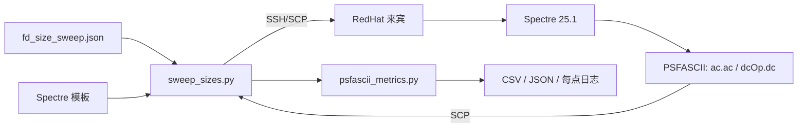

# 自动化架构

## 数据流

## Python 组件

### `sweep_sizes.py`

- 从 JSON 读取任意参数组合；
- 用参数名精确替换 Spectre 模板；
- 每个扫描点建立独立远程目录；
- 通过 SSH 调用 Spectre；
- 下载 `ac.ac` 和 `dcOp.dc`；
- 输出 CSV、JSON、网表和日志；
- 任一阶段失败时记录 `ssh_error`、`upload_error`、`spectre_error` 或
  `fetch_error`，不会把失败点伪装成有效结果。

### `psfascii_metrics.py`

- 解析 Spectre PSFASCII；
- 支持 `V(out)-V(ym)` 差分输出；
- 对相位连续展开；
- 在对数频率轴上插值第一个下降沿 0 dB 交点；
- 提取增益、UGF、相位裕度、输出 DC 和电源电流。

### `remote_ocean.py`

- 上传任意 `.ocn/.il`；
- 使用任务专用 SSH 密钥；
- 设置来宾 X Display；
- 调用 OCEAN 并使用独立日志。

## OCEAN/SKILL 组件

- `create_schematic.ocn`：创建 OA library/cell/view、11 个 PDK MOS、网络、
  端口及 W/L/nf；
- `verify_schematic.ocn`：从新的 Cadence 进程只读打开 schematic 并检查对象数；
- `smoke.ocn`：生成 `CODEX_OCEAN_OK`，用于验证 OCEAN 解释器和许可。

## 可扩展方向

- 将扫描配置扩展到偏置、电容和 PVT；
- 加入 Monte Carlo、噪声、瞬态和压摆率；
- 为指定闭环网络加入 `iprobe + stb`；
- 用优化器替换固定网格；
- 将结果接入数据库或可视化仪表板。

