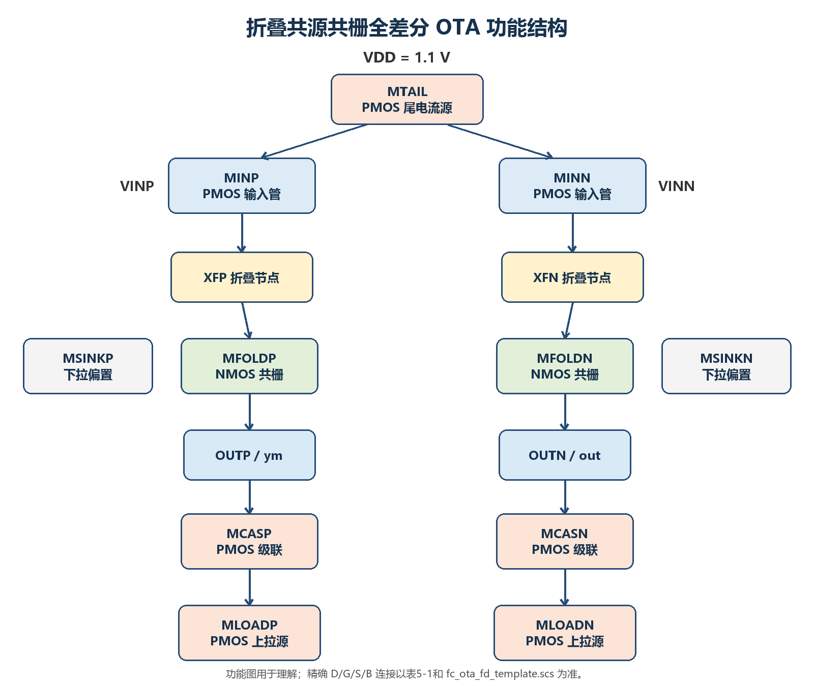
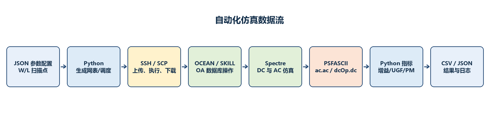
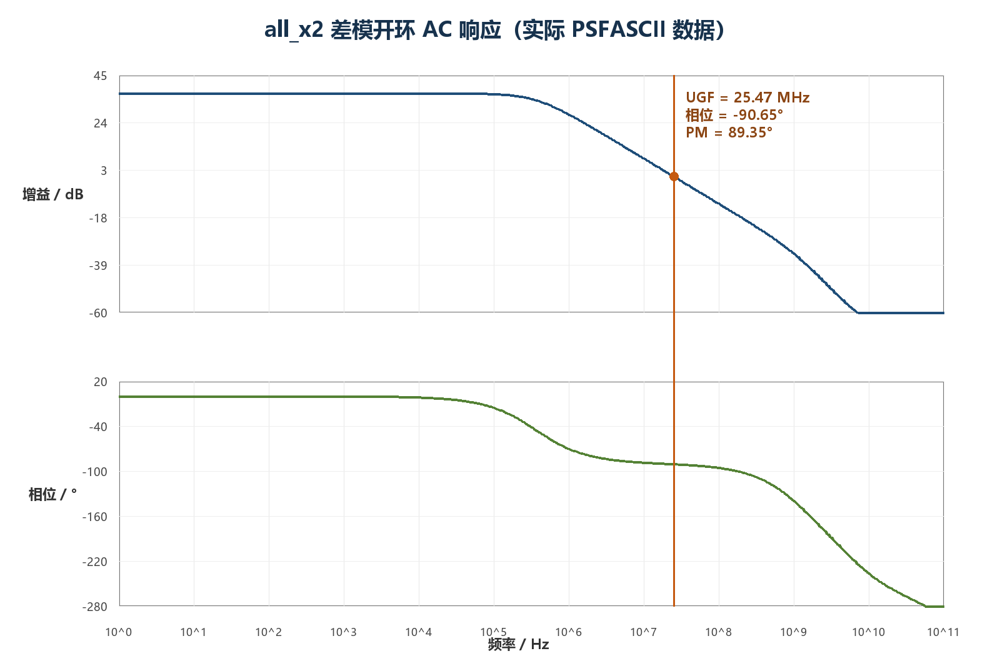
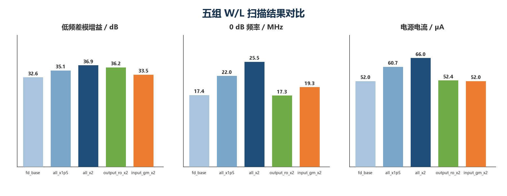

# 折叠共源共栅全差分 OTA 设计与自动化仿真实验报告

## 基于 Cadence Virtuoso、Spectre、OCEAN/SKILL 与 Python

课程名称：____________________________  
学生姓名：____________________________  
学号班级：____________________________  
指导教师：____________________________  
提交日期：2026 年 ____ 月 ____ 日  

## 摘要

本实验在 TSMC 40 nm CRN40LP 工艺环境下设计了一款 PMOS 输入的折叠共源共栅全差分运算跨导放大器（Operational Transconductance Amplifier，OTA），并建立了由 Cadence Virtuoso、Spectre、OCEAN/SKILL、SSH 和 Python 组成的自动化仿真流程。核心电路包含 11 只 MOSFET，采用 1.1 V 电源、电阻性偏置等效电压源、理想连续时间共模反馈和每端 1 pF 负载。通过 DC 工作点和 1 Hz～100 GHz 小信号 AC 扫描，自动提取低频差模增益、0 dB/单位增益频率、交越相位、相位裕度估算、输出共模电压和电源电流。五组 W/L 扫描中，`all_x2` 点取得最高综合性能：低频差模增益 36.93 dB，0 dB 频率 25.47 MHz，交越相位 -90.65°，相位裕度估算 89.35°，输出共模约 0.554 V，电源电流约 66.0 µA。实验表明，适当增加关键器件沟道长度并同步增加宽度可以提高输出电阻和增益，但会增加电流、面积和寄生电容。当前结果属于典型角原理图级小信号验证，尚不能替代晶体管级共模反馈、STB、PVT、Monte Carlo 及版图后仿真。

关键词：折叠共源共栅；全差分 OTA；共模反馈；Virtuoso；Spectre；OCEAN；Python 自动仿真

# 1 实验任务与设计目标

## 1.1 实验任务

本实验的任务是在现有 TSMC 40 nm PDK 和 Cadence IC25.1/Spectre 25.1 环境中完成以下工作：

- 搭建折叠共源共栅全差分 OTA 原理图；
- 建立 DC 工作点与差模 AC 测试平台；
- 提取低频差模增益、0 dB 频率和相位裕度估算；
- 检查输出共模电压和电源电流；
- 使用 OCEAN/SKILL 创建并验证 Virtuoso OA 原理图；
- 使用 Python 经 SSH 调用 Linux 虚拟机中的 Spectre，自动修改 MOS W/L；
- 比较不同尺寸组合的性能并分析尺寸变化规律。

## 1.2 实验环境

|项目|配置|
|---|---|
|工艺与器件库|TSMC 40 nm CRN40LP，`tsmcN40`|
|模型入口与工艺角|`/PDKS/TSMC40nm/models/spectre/toplevel.scs`，`top_tt`|
|电源电压|1.1 V|
|Cadence 环境|Virtuoso/OCEAN IC25.1，Spectre 25.1.0.054|
|操作系统|Windows 主机 + Red Hat Enterprise Linux 9.7 虚拟机|
|远程控制|SSH/SCP 公钥认证|
|核心 OA 设计|`codex_fc_ota/folded_cascode_ota/schematic`|
|工程路径|`F:\VirtuosoFoldedCascodeProject`|

## 1.3 已完成的可验证对象

新的 OCEAN 进程可以只读打开核心 OA schematic，并得到 11 个实例、16 个网络和 11 个端口。Spectre 最终五个扫描点均返回 `status=ok`；`all_x2` 日志以 0 errors 完成。Python 单元测试覆盖相位连续展开和 0 dB 交越插值。

# 2 理论基础

## 2.1 MOSFET 小信号参数

在长沟道平方律近似下，NMOS 饱和区漏极电流可写为：

`ID = (1/2) μnCox(W/L)(VGS-VTH)^2`

定义过驱动电压 `Vov=VGS-VTH`，则跨导近似为：

`gm = ∂ID/∂VGS ≈ 2ID/Vov`

考虑沟道长度调制后，输出电阻近似为 `ro≈1/(λID)`，单管本征增益约为 `gmro`。40 nm 器件存在速度饱和、迁移率退化等短沟道效应，因此上述公式主要用于理解趋势，精确结果必须使用 PDK 的 BSIM 模型。

普通共源级的低频增益可近似表示为 `Av≈-gmRout`。共源共栅器件利用局部负反馈减小被级联器件漏端电压变化，使支路输出电阻提高到约 `gmro²` 的量级，从而提高一级放大器增益。代价是消耗更多电压裕量，并产生内部高阻或低阻节点及附加极点。

## 2.2 差模与共模

差模输入和输入共模定义为：

`Vid=Vinp-Vinn`  
`Vicm=(Vinp+Vinn)/2`

全差分输出的差模量和共模量为：

`Vod=Voutp-Voutn`  
`Vocm=(Voutp+Voutn)/2`

全差分电路的差模反馈不能唯一确定输出平均值，因此必须增加共模反馈（Common-Mode Feedback，CMFB）。CMFB 检测 `Vocm` 与目标共模之间的误差，并调节公共偏置，使输出远离电源轨并保持各 MOSFET 的合理工作区。

## 2.3 折叠共源共栅原理

望远镜式共源共栅把输入管、共栅管和负载串接在同一支路，功耗效率较好，但低电源电压下输入共模和输出摆幅受限。折叠共源共栅把输入差分对产生的增量电流送入另一类型或另一方向的共栅支路，使输入支路和输出级联支路不必全部垂直堆叠。本实验采用 PMOS 输入对，输入电流在 `XFP/XFN` 节点折叠到 NMOS 共栅管，再与 PMOS 级联负载共同形成高阻全差分输出。



# 3 电路设计

## 3.1 电路组成

核心电路由六类器件组成：`MTAIL` 为 PMOS 尾电流源；`MINP/MINN` 为 PMOS 差分输入对；`MSINKP/MSINKN` 为折叠节点下拉偏置；`MFOLDP/MFOLDN` 为 NMOS 共栅折叠管；`MLOADP/MLOADN` 为 PMOS 上拉电流源；`MCASP/MCASN` 为 PMOS 级联管。`OUTP/OUTN` 是全差分输出，`VBPL` 被引出，供测试平台中的 CMFB 调节。

## 3.2 最终 all_x2 器件连接与尺寸

|器件|类型|D|G|S|B|W|L|nf|
|---|---|---|---|---|---|---:|---:|---:|
|MTAIL|PMOS|VSRC|VBP|VDD|VDD|20 µm|480 nm|4|
|MINP|PMOS|XFP|VINP|VSRC|VDD|40 µm|400 nm|6|
|MINN|PMOS|XFN|VINN|VSRC|VDD|40 µm|400 nm|6|
|MSINKP|NMOS|XFP|VBN|VSS|VSS|10 µm|480 nm|2|
|MSINKN|NMOS|XFN|VBN|VSS|VSS|10 µm|480 nm|2|
|MFOLDP|NMOS|OUTP/ym|VCASN|XFP|VSS|20 µm|480 nm|4|
|MFOLDN|NMOS|OUTN/out|VCASN|XFN|VSS|20 µm|480 nm|4|
|MLOADP|PMOS|ZP|VBPL|VDD|VDD|20 µm|640 nm|4|
|MLOADN|PMOS|ZN|VBPL|VDD|VDD|20 µm|640 nm|4|
|MCASP|PMOS|OUTP/ym|VPCAS|ZP|VDD|20 µm|480 nm|4|
|MCASN|PMOS|OUTN/out|VPCAS|ZN|VDD|20 µm|480 nm|4|

连接关系同时由 `circuit/ocean/create_schematic.ocn` 和 `circuit/spectre/fc_ota_fd_template.scs` 交叉确认。Spectre MOS 实例采用 `(D G S B)` 顺序。PMOS bulk 接 VDD，NMOS bulk 接 VSS。

## 3.3 偏置与共模反馈

测试平台的偏置为 `VBP=0.62 V`、`VBN=0.48 V`、`VCASN=0.78 V`、`VPCAS=0.45 V`。CMFB 使用行为电压源：

`V(VBPL)=VBPL0+ACMFB×[(V(out)+V(ym))/2-VCMOUT]`

其中 `VBPL0=0.552 V`、`ACMFB=1`、`VCMOUT=0.55 V`。输出平均值升高时，VBPL 升高，使 PMOS 上拉电流下降，输出共模回落，因此形成负反馈。该实现用于保证不同 W/L 点具有可比较的 DC 工作点，但不包含晶体管级 CMFB 的噪声、失调、带宽、摆幅和功耗。

# 4 仿真平台与实验方法

## 4.1 测试条件

|参数|设置|
|---|---:|
|VDD|1.1 V|
|输入共模 VCM|0.55 V|
|输出目标共模|0.55 V|
|输入 AC|VINP：0.5∠0°；VINN：0.5∠180°|
|总差模 AC 幅度|1 V|
|输出负载|1 pF/输出|
|DC 分析|`dcOp dc write="dcOp"`|
|AC 扫描|1 Hz～100 GHz，50 点/十倍频|
|工艺角与温度|top_tt，27 °C|

两输入端等幅反相，因此 `Vinp-Vinn=1 V`。Python 后处理计算 `V(out)-V(ym)`，其复数幅值可以直接作为差模开环增益。低频增益取 1 Hz 点；0 dB 频率取增益第一次由正值向下穿越 0 dB 的位置。

## 4.2 指标计算方法

差模增益为：

`Gain_dB(f)=20log10|[V(out)-V(ym)]/[Vinp-Vinn]|`

程序在相邻两个采样点 `G1≥0 dB`、`G2<0 dB` 之间对 `log10(f)` 进行插值。相位由复数波形的 `atan2` 得到，并通过加减 360°进行连续展开。交越处的相位裕度估算为：

`PM=180°+phase(fu)`

该 PM 是差模开环 AC 传递函数的估算结果。若要形成正式闭环稳定性结论，应在确定的反馈断点使用 `iprobe+stb` 测量环路增益，并单独检查差模环路与 CMFB 环路。

## 4.3 实验步骤

1. 通过 SSH 验证 Linux 虚拟机和 ocean、spectre、virtuoso 路径。
2. 运行 `smoke.ocn`，确认 OCEAN、许可证和 X 环境可用。
3. 执行 `create_schematic.ocn` 创建 OA schematic，再用 `verify_schematic.ocn` 检查实例、网络和端口数量。
4. 使用 Spectre 模板运行 DC 工作点，确认输出对称、内部节点未明显贴近电源轨且电流方向正确。
5. 运行差模 AC 扫描，保存 PSFASCII 格式 `ac.ac` 与 `dcOp.dc`。
6. 使用 Python 解析复数波形并提取增益、UGF、PM、输出和电源电流。
7. 根据 JSON 配置依次生成五组 W/L 网表，经 SSH/SCP 运行 Spectre。
8. 保存每点网表、日志和原始结果，汇总为 CSV/JSON。

# 5 自动化仿真设计

## 5.1 自动化架构



`remote_ocean.py` 负责上传 OCEAN/SKILL 文件、设置来宾 DISPLAY/XAUTHORITY 并返回 OCEAN 退出码；`sweep_sizes.py` 读取 JSON、精确替换 Spectre parameters、逐点上传网表、运行 Spectre 和下载结果；`psfascii_metrics.py` 解析 AC/DC 文件、计算差分波形、相位展开和交越插值；PowerShell 脚本提供统一入口。

## 5.2 错误处理与可复现性

每个扫描点建立独立的本地和远程目录。SSH 创建失败、上传失败、Spectre 失败和结果下载失败分别记录为 `ssh_error`、`upload_error`、`spectre_error` 和 `fetch_error`；只有完成全部步骤的点才标记 `ok`。新运行写入 `results/generated`，不会覆盖 `results/final`。工程不保存账户密码或 SSH 私钥；F 盘为 exFAT，私钥位于受 ACL 保护的用户 `.ssh` 目录。

# 6 仿真结果

## 6.1 all_x2 直流工作点

`results/runs/fd_cmfb_runs/all_x2/dcOp.dc` 给出的主要节点为：VDD=1.1 V，VSRC=0.960 V，XFP=XFN=0.312 V，ZP=ZN=0.975 V，out=ym=0.5537 V，VBPL=0.5557 V。电源支路 `VDD:p=-66.00 µA`，按照电源向电路供电的正方向，电源电流取 `-I(VDD:p)=66.00 µA`。

左右节点严格对称，说明零差模输入时数值解对称且 CMFB 能把输出稳定在约 0.55 V 附近。但当前 DC 文件只保存节点和支路量，没有保存每只 MOS 的 `region`、`vdsat`、`gm` 和 `gds`，所以不能仅凭该文件严格证明所有器件均工作在饱和区。后续需要保存器件 operating point 并逐管核对。

## 6.2 差模 AC 结果



all_x2 在 1 Hz 的差模增益为 36.9265 dB，对应线性增益约 70.2 V/V。第一次下降沿 0 dB 交越频率为 25.4686 MHz，交越相位为 -90.6455°，因此相位裕度估算为 89.3545°。曲线在低频处平坦，随后呈现主极点下降趋势；更高频率处出现额外相位下降，反映内部节点和寄生电容形成的非主极点。

## 6.3 W/L 扫描结果

|组合|增益/dB|0 dB频率/MHz|PM/°|输出共模/V|电流/µA|
|---|---:|---:|---:|---:|---:|
|fd_base|32.56|17.38|90.92|0.550|51.96|
|all_x1p5|35.08|22.05|90.15|0.553|60.67|
|all_x2|36.93|25.47|89.35|0.554|66.00|
|output_ro_x2|36.19|17.28|89.91|0.573|52.38|
|input_gm_x2|33.54|19.31|90.56|0.551|51.98|



# 7 结果分析与讨论

## 7.1 尺寸变化的影响

`all_x1p5` 和 `all_x2` 同时增加所有器件 W 和 L，名义 W/L 大致保持不变。理想平方律下电流似乎应近似不变，但实际 BSIM 模型中绝对沟道长度会改变沟道长度调制、输出电阻和短沟道效应；宽度、栅指数及结面积会改变寄生参数；工作点电流也实际增加。因此，增益从 32.56 dB 提高到 36.93 dB，UGF 从 17.38 MHz 提高到 25.47 MHz，同时电流升至 66.00 µA。

`output_ro_x2` 主要加大折叠和 PMOS 负载/级联器件，使输出电阻提高，增益达到 36.19 dB，而 UGF 仍约 17.28 MHz。这说明提高 ro 的同时附加电容增大，增益提升没有直接转化为速度提升。`input_gm_x2` 只增加输入管宽度，增益和 UGF 仅小幅增加，表明本电路不仅受输入 gm 限制，输出支路 ro 也是关键因素。

## 7.2 最优点选择

在当前五个候选点中，all_x2 同时取得最高增益和最高 UGF，输出共模接近目标，且 PM 估算仍接近 90°，因此作为本次实验的最佳综合点。其代价是电流和器件面积最大。如果后续目标强调低功耗，可比较 output_ro_x2；如果强调精度，则 36.93 dB 仍偏低，需要进一步提高开环增益或采用增益增强等结构。

## 7.3 结果边界

本实验只能证明典型角、27 °C、1.1 V、理想偏置、行为 CMFB 和 1 pF 负载条件下的原理图级 DC/AC 性能。当前未完成晶体管级 CMFB、STB、输入共模范围、输出摆幅、压摆率、建立时间、CMRR、PSRR、噪声、PVT、Monte Carlo、版图和 PEX 后仿真，因此不能据此宣称电路已满足流片要求。

# 8 实验中遇到的问题及解决方法

1. **非交互 SSH/SCP 被 `.bashrc` 欢迎信息干扰。** 通过给欢迎输出增加交互 shell 判断，保留原文件备份，使 SCP 协议不再被额外文本破坏。
2. **OCEAN 的无图形包装器依赖缺失。** 当前虚拟机未安装 Xvfb，因此设置 `DISPLAY=:1` 和正确 XAUTHORITY，复用已登录 GNOME 会话。
3. **项目盘不支持私钥 ACL。** F 盘为 exFAT，无法安全限制私钥权限，因此私钥迁移到 Windows 用户 NTFS `.ssh` 目录，项目只保留公钥。
4. **相位存在 ±360°跳变。** Python 使用相邻点差值约束进行 phase unwrap，再在对数频率轴上插值交越相位。
5. **CMFB 缺失时不同尺寸点的输出共模不可比。** 在测试平台引入行为 CMFB，使扫描点具有可比较的 DC 状态，同时保留 OA 核心的 VBPL 端口，便于后续接入真实 CMFB。

# 9 改进方案

后续工作可按以下顺序展开：

- 保存全部 MOS operating point，确认 region、VDSAT、gm、gds 与电流密度；
- 建立单位增益闭环测试，完成输出摆幅、压摆率和建立时间仿真；
- 设计晶体管级共模检测和误差放大器，并分别对差模环路、CMFB 环路运行 STB；
- 增加输入共模扫描、CMRR、PSRR、noise 和失调分析；
- 完成 TT/FF/SS/FS/SF、温度、电源电压和 Monte Carlo；
- 使用 gm/Id 数据库优化电流效率，扩大 Python 搜索空间；
- 完成版图、DRC、LVS、PEX 及后仿真，并比较寄生前后指标退化。

# 10 实验结论

本实验完成了 PMOS 输入折叠共源共栅全差分 OTA 的原理图设计、Spectre DC/AC 仿真和 Python 自动 W/L 扫描。Virtuoso OA 数据库中的核心电路包含 11 只 MOS、16 个网络和 11 个端口；五个尺寸点均成功完成仿真。最佳 all_x2 点在 1.1 V、top_tt、27 °C 和每端 1 pF 条件下获得 36.93 dB 低频差模增益、25.47 MHz 0 dB 频率、89.35°相位裕度估算、0.554 V 输出共模和 66.0 µA 电源电流。

实验验证了共源共栅提高输出电阻、器件绝对尺寸影响 ro 与寄生、电路指标之间存在增益—速度—功耗折中的基本规律。自动化部分实现了参数配置、网表生成、SSH/SCP、Spectre 运行、PSFASCII 解析和 CSV/JSON 汇总的完整闭环，提高了实验的可复现性。与此同时，行为 CMFB、开环 AC 相位裕度估算和典型角原理图级结果仍属于阶段性验证，需要通过真实 CMFB、STB、PVT/统计和版图后仿真继续完善。

# 参考资料与工程依据

1. Behzad Razavi，《模拟 CMOS 集成电路设计》。
2. Paul R. Gray 等，《Analysis and Design of Analog Integrated Circuits》。
3. Cadence Spectre Circuit Simulator 与 OCEAN/SKILL 使用文档。
4. 工程文件 `circuit/spectre/fc_ota_fd_template.scs`。
5. 工程文件 `circuit/ocean/create_schematic.ocn` 与 `verify_schematic.ocn`。
6. 工程文件 `src/python/sweep_sizes.py` 与 `psfascii_metrics.py`。
7. 权威结果 `results/final/fd_cmfb_sweep_results.csv`。
8. 原始数据 `results/runs/fd_cmfb_runs/all_x2/ac.ac`、`dcOp.dc` 和 `spectre.stdout.log`。

# 附录A 主要运行命令

```powershell
cd F:\VirtuosoFoldedCascodeProject
powershell -ExecutionPolicy Bypass -File .\scripts\verify_remote.ps1
.\scripts\test.ps1
.\scripts\run_ocean.ps1 circuit\ocean\smoke.ocn
.\scripts\run_ocean.ps1 circuit\ocean\verify_schematic.ocn
.\scripts\run_final_sweep.ps1
```

# 附录B 报告提交前检查

- [ ] 填写课程名称、姓名、学号班级、指导教师和日期；
- [ ] 根据课程要求补充学校封面或实验日期；
- [ ] 在 Word 中更新目录与页码并检查分页；
- [ ] 确认图表在打印或 PDF 中清晰；
- [ ] 若导师要求“相位裕度”，说明当前为开环 AC 估算，并提出 STB 改进；
- [ ] 不在报告中附带登录密码、SSH 私钥或受限 PDK 模型正文。
