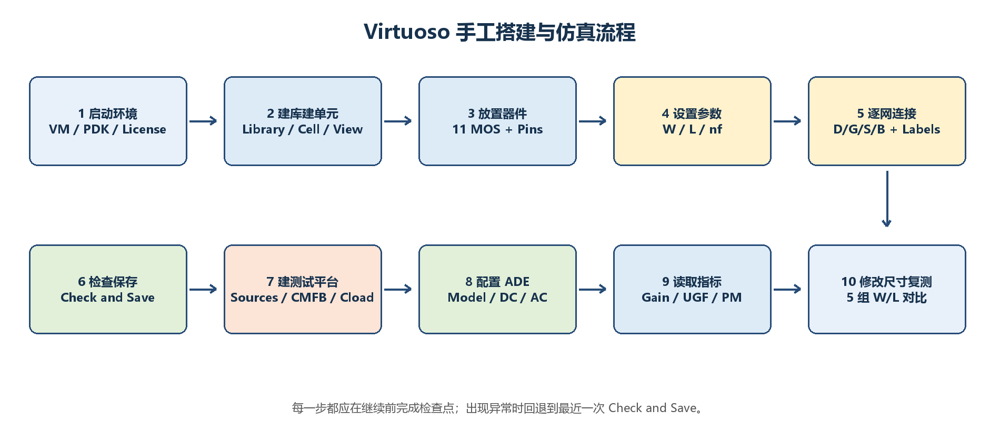
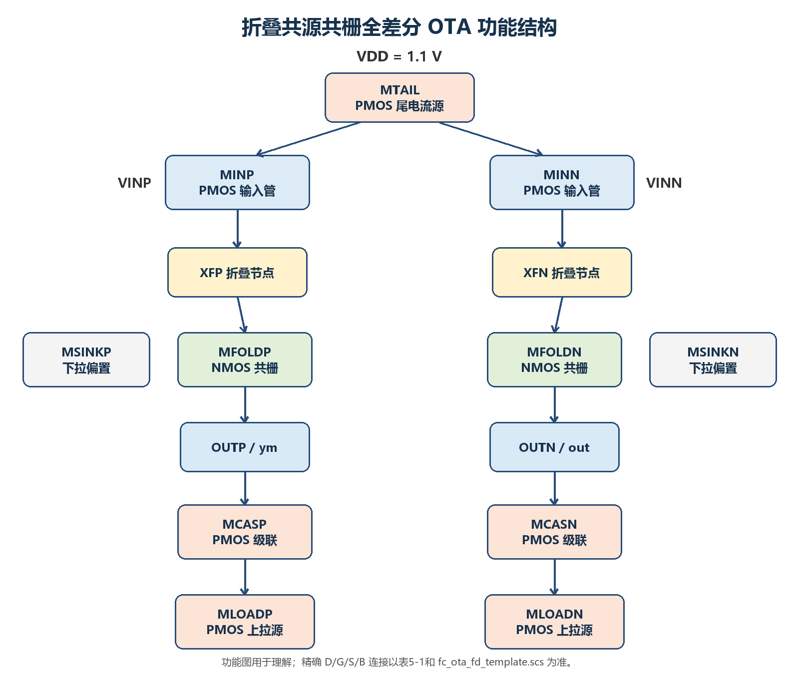
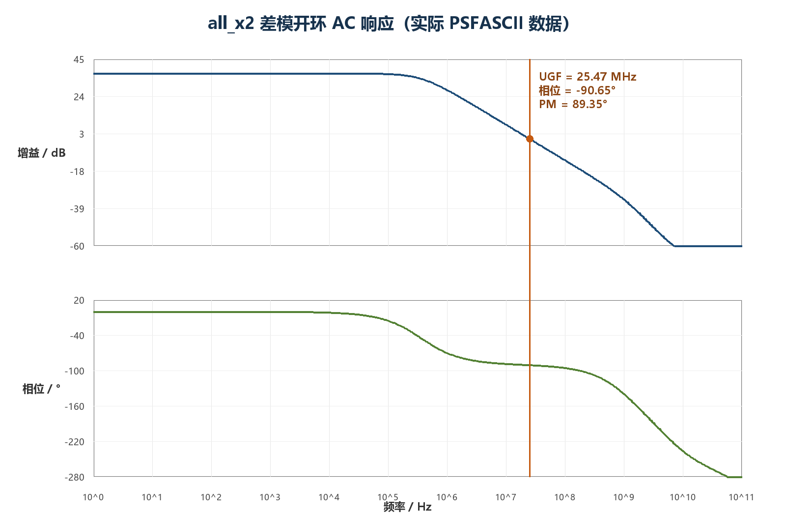
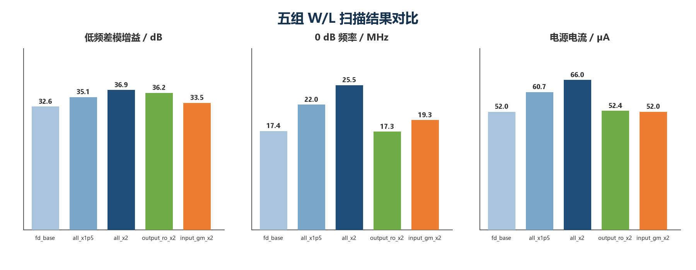

# Cadence Virtuoso 手工搭建折叠共源共栅全差分 OTA 与完整仿真操作指导书

## 从空白 Library 到增益、0 dB 频率和相位裕度结果

适用工程：`F:\VirtuosoFoldedCascodeProject`  
工艺环境：TSMC 40 nm CRN40LP / `tsmcN40`  
Cadence 版本：Virtuoso IC25.1 / Spectre 25.1  
目标读者：首次独立完成模拟集成电路原理图与 ADE 仿真的本科生  

## 使用说明

本文讲解如何完全通过 Virtuoso GUI 和 ADE 手工完成电路搭建与仿真。文中的连接、尺寸、偏置和预期结果均来自已经验证的工程，而不是通用示例。不同 Virtuoso/ADE 小版本的菜单名称可能略有差异；若菜单文字不同，应寻找同名功能，不要机械照抄坐标位置。

手工流程的目标是让操作者真正理解每只管、每个节点和每项仿真设置。自动化脚本仍可用于最后交叉验证，但不作为本文完成电路的必要条件。

> 安全提示：不要把虚拟机账户密码、SSH 私钥或 PDK 模型正文写进实验报告、脚本或公开仓库。PDK 和 Cadence 软件按实验室授权使用。

# 第1章 最终应完成什么

## 1.1 最终交付对象

完成本指导书后，应得到以下对象：

- Virtuoso Library：`codex_fc_ota`；
- 核心 Cell/View：`folded_cascode_ota/schematic`；
- 建议的 Symbol：`folded_cascode_ota/symbol`；
- 建议的测试平台：`folded_cascode_ota_tb/schematic`；
- 核心电路：11 只 MOS、16 个网络、11 个外部端口；
- DC 工作点结果；
- 差模 AC 幅频和相频曲线；
- 低频增益、0 dB 频率、交越相位与相位裕度估算；
- 五组 W/L 的手工或 ADE 参数化对比表。



## 1.2 目标仿真条件与参考结果

|项目|目标值|
|---|---:|
|电源电压|1.1 V|
|输入共模|0.55 V|
|输出目标共模|0.55 V|
|差模 AC 总幅度|1 V|
|负载|1 pF/输出端|
|工艺角|top_tt|
|温度|27 °C|
|AC 扫描|1 Hz～100 GHz，50 点/十倍频|
|参考低频增益|36.93 dB|
|参考 0 dB 频率|25.47 MHz|
|参考交越相位|-90.65°|
|参考相位裕度估算|89.35°|
|参考输出共模|0.554 V|
|参考电源电流|66.0 µA|

这些结果对应 `all_x2` 尺寸点、行为源 CMFB 和原理图级典型角仿真。手工结果应接近而不必最后一位完全相同；若偏差很大，应优先检查尺寸含义、器件端口、bulk、输入 AC 极性、CMFB 表达式和模型角。

# 第2章 开始前的准备

## 2.1 启动虚拟机并检查环境

1. 启动 VMware 中安装 Cadence 的 Red Hat 9.7 虚拟机。
2. 登录图形桌面。当前 OCEAN 使用 `DISPLAY=:1`，但纯 GUI 手工操作本身也需要桌面会话。
3. 打开 Linux Terminal，执行 `hostname`、`pwd`，确认自己处于普通设计用户环境，不要用 root 运行 Virtuoso。
4. 执行 `which virtuoso`、`which spectre`、`which ocean`。预期路径分别位于 IC251 和 SPECTRE251 安装目录。
5. 若命令找不到，加载实验室提供的 Cadence 环境脚本；不要凭猜测修改全局 PATH。
6. 启动前确认许可证可用。可以直接运行 `virtuoso &`；若出现 license checkout 失败，应先处理许可证，不要继续改电路。

检查点：Virtuoso CIW（Command Interpreter Window）能够正常出现，Library Manager 可打开，CIW 中无致命 license error。

建议截图：Virtuoso CIW、Library Manager 和终端中的工具路径。

## 2.2 确认 PDK

在 Library Manager 左侧库列表中寻找 `tsmcN40`。展开后检查是否存在 `nch`、`pch` cell 和 `symbol` view。若库不可见：

1. 在 CIW 查看当前工作目录与 `cds.lib`；
2. 检查 `cds.lib` 是否包含实验室提供的 PDK DEFINE/INCLUDE；
3. 不要把 PDK 目录直接复制进个人工程；
4. 避免对同一个逻辑库重复 DEFINE，否则会产生 library redefinition warning；
5. PDK 修复后重新打开 Library Manager，必要时重启 Virtuoso。

检查点：能在只读方式打开 `tsmcN40/nch/symbol` 和 `tsmcN40/pch/symbol`，器件属性中能看到 W/L、Wfg、nf 或 fingers 等参数。

## 2.3 建议的工作习惯

- 每完成一组器件或一条功能支路就执行一次 Check and Save；
- 所有网络使用清晰名称，不依赖长导线猜测连接；
- 修改前记录上一次能工作的版本；
- 先完成固定尺寸的 all_x2，再做变量化和参数扫描；
- 首次仿真先做 DC，再做 AC；DC 不正确时不要分析 Bode 图；
- 每次修改只改变一类问题，避免同时改拓扑、偏置和尺寸。

# 第3章 在放器件前先读懂连接表

## 3.1 外部端口

|端口|方向|功能|
|---|---|---|
|VDD|inputOutput|1.1 V 电源|
|VSS|inputOutput|地或 0 V|
|VINP|input|差分正输入|
|VINN|input|差分负输入|
|VBP|input|PMOS 尾电流源偏置|
|VBN|input|NMOS 下拉偏置|
|VCASN|input|NMOS 折叠共栅偏置|
|VBPL|input|PMOS 上拉源/CMFB 控制|
|VPCAS|input|PMOS 级联偏置|
|OUTP|output|左侧差分输出，对应网表 ym|
|OUTN|output|右侧差分输出，对应网表 out|

## 3.2 内部节点

|节点|连接器件|作用|
|---|---|---|
|VSRC|MTAIL.D、MINP.S、MINN.S|输入对公共源节点|
|XFP|MINP.D、MSINKP.D、MFOLDP.S|左侧折叠节点|
|XFN|MINN.D、MSINKN.D、MFOLDN.S|右侧折叠节点|
|ZP|MLOADP.D、MCASP.S|左侧 PMOS 级联内部节点|
|ZN|MLOADN.D、MCASN.S|右侧 PMOS 级联内部节点|

## 3.3 all_x2 的逐管连接和尺寸

|器件|类型|D|G|S|B|W|L|nf|
|---|---|---|---|---|---|---:|---:|---:|
|MTAIL|PMOS|VSRC|VBP|VDD|VDD|20 µm|480 nm|4|
|MINP|PMOS|XFP|VINP|VSRC|VDD|40 µm|400 nm|6|
|MINN|PMOS|XFN|VINN|VSRC|VDD|40 µm|400 nm|6|
|MSINKP|NMOS|XFP|VBN|VSS|VSS|10 µm|480 nm|2|
|MSINKN|NMOS|XFN|VBN|VSS|VSS|10 µm|480 nm|2|
|MFOLDP|NMOS|OUTP|VCASN|XFP|VSS|20 µm|480 nm|4|
|MFOLDN|NMOS|OUTN|VCASN|XFN|VSS|20 µm|480 nm|4|
|MLOADP|PMOS|ZP|VBPL|VDD|VDD|20 µm|640 nm|4|
|MLOADN|PMOS|ZN|VBPL|VDD|VDD|20 µm|640 nm|4|
|MCASP|PMOS|OUTP|VPCAS|ZP|VDD|20 µm|480 nm|4|
|MCASN|PMOS|OUTN|VPCAS|ZN|VDD|20 µm|480 nm|4|

> 尺寸输入提示：PDK CDF 可能显示 `w`、`Wfg`、`nf`、`fingers` 等字段。不要自行把表中 W 除以 nf。先按项目值输入 W 和 nf，然后在 ADE 生成的 Spectre netlist 中确认实例最终为 `w=目标值 l=目标值 nf=目标值`。若实际 PDK 文档规定 Wfg 是每指宽，应以最终网表与 PDK 说明为准。



# 第4章 创建 Library、Cell 和 Schematic

## 4.1 创建 Library

1. 在 Library Manager 选择 `File > New > Library`。
2. Library Name 输入 `codex_fc_ota`。若该库已经存在，为练习可新建 `codex_fc_ota_manual`，但后续路径和测试平台必须保持一致。
3. 选择保存目录，例如 `/home/userone/codex_fc_ota`。
4. 工艺绑定方式按实验室 PDK 规范选择：若要求 Attach to an existing technology library，则绑定 TSMC40 对应 technology library；若仅做 schematic 且环境由 PDK 管理，也可按实验室模板创建。
5. 完成后确认 Library Manager 出现新库，CIW 无创建失败信息。

检查点：`cds.lib` 中能解析新库路径；重新打开 Library Manager 后库仍存在。

## 4.2 创建核心 schematic

1. 选中新库，执行 `File > New > Cell View`。
2. Cell Name 输入 `folded_cascode_ota`。
3. View Name 选择 `schematic`。
4. Tool 选择 Virtuoso Schematic Editor。
5. 打开空白 schematic 后立即保存一次。
6. 打开 `Options > Editor` 或网格设置，保持适合器件对齐的 snap spacing。

建议布局：把 VDD 放在图上方、VSS 放在下方；左右两路严格对称；输入对位于上中部；折叠节点和 NMOS 共栅位于中部；PMOS 负载/级联支路放在输出上方或按信号流清晰排列。原理图布局不改变电气结果，但决定后续检查是否容易。

# 第5章 手工放置并设置 11 只 MOS

## 5.1 放置 MTAIL 和输入对

1. 按 `i` 或选择 `Create > Instance`。
2. Library 选择 `tsmcN40`，Cell 选择 `pch`，View 选择 `symbol`。
3. 放置第一只 PMOS，按 `q` 打开属性，将 Instance Name 设为 `MTAIL`。
4. 设置 W=20 µm、L=480 nm、nf/fingers=4。
5. 再放置两只 PMOS，命名 `MINP`、`MINN`，分别设置 W=40 µm、L=400 nm、nf=6。
6. 让 MINP、MINN 左右对称，源端朝向公共 VSRC，栅端朝外便于连接 VINP/VINN。
7. PMOS bulk 必须接 VDD；若 symbol 有独立 B 端，不得悬空。

检查点：三只器件名称唯一，主器件均为 `tsmcN40/pch`，属性不是默认 120 nm 宽度。

## 5.2 放置下拉偏置与折叠管

1. 从 `tsmcN40/nch/symbol` 放置 `MSINKP`、`MSINKN`。
2. 设置 W=10 µm、L=480 nm、nf=2。
3. 再放置 `MFOLDP`、`MFOLDN`，设置 W=20 µm、L=480 nm、nf=4。
4. 让 MSINKP/MFOLDP 靠近左侧 XFP，MSINKN/MFOLDN 靠近右侧 XFN。
5. NMOS bulk 全部接 VSS。

检查点：MFOLD 的源端连接折叠节点，漏端连接输出；不要把 D/S 仅按图形上下位置猜测，应查看 symbol 端口名。

## 5.3 放置 PMOS 上拉负载与级联管

1. 放置 `MLOADP`、`MLOADN`，设置 W=20 µm、L=640 nm、nf=4。
2. 放置 `MCASP`、`MCASN`，设置 W=20 µm、L=480 nm、nf=4。
3. MLOAD 的源和 bulk 接 VDD，漏端形成 ZP/ZN。
4. MCAS 的源端接 ZP/ZN，漏端接 OUTP/OUTN，栅端接 VPCAS，bulk 接 VDD。

检查点：MLOAD 的栅极不是 VPCAS，而是 VBPL；MCAS 的栅极才是 VPCAS。

# 第6章 逐网连接核心电路

## 6.1 先建立电源和公共节点

1. 使用 wire 工具连接 MTAIL.S 和 MTAIL.B 到 VDD。
2. 连接 MLOADP.S/B、MLOADN.S/B、MCASP.B、MCASN.B 到 VDD。
3. 连接所有 NMOS bulk 和 MSINK 源端到 VSS。
4. 连接 MTAIL.D、MINP.S、MINN.S，给该网加 label `VSRC`。
5. 执行一次 Check and Save，先消除悬空 bulk 和明显短路。

## 6.2 连接左支路

严格按以下顺序核对：

1. MINP.D → XFP；
2. MSINKP.D → XFP；
3. MFOLDP.S → XFP；
4. MFOLDP.D → OUTP；
5. MLOADP.D → ZP；
6. MCASP.S → ZP；
7. MCASP.D → OUTP；
8. MINP.G → VINP；
9. MSINKP.G → VBN；
10. MFOLDP.G → VCASN；
11. MLOADP.G → VBPL；
12. MCASP.G → VPCAS。

完成后给内部网加 `XFP`、`ZP` label，输出网加 `OUTP` label。使用 Connectivity/Highlight 功能点选 XFP，确认恰好连接 MINP.D、MSINKP.D、MFOLDP.S，不应碰到右支路。

## 6.3 连接右支路

1. MINN.D → XFN；
2. MSINKN.D → XFN；
3. MFOLDN.S → XFN；
4. MFOLDN.D → OUTN；
5. MLOADN.D → ZN；
6. MCASN.S → ZN；
7. MCASN.D → OUTN；
8. MINN.G → VINN；
9. MSINKN.G → VBN；
10. MFOLDN.G → VCASN；
11. MLOADN.G → VBPL；
12. MCASN.G → VPCAS。

给内部网加 `XFN`、`ZN` label，输出加 `OUTN` label。左右结构应镜像，但 OUTP 和 OUTN 不能短接。

## 6.4 创建 11 个 pin

使用 `Create > Pin`，依次创建：VDD、VSS、VINP、VINN、VBP、VBN、VCASN、VBPL、VPCAS、OUTP、OUTN。

- VINP、VINN、VBP、VBN、VCASN、VBPL、VPCAS 设为 input；
- OUTP、OUTN 设为 output；
- VDD、VSS 可按 PDK/课程规范设为 inputOutput；
- pin 名必须与 net label 完全一致，避免多余空格；
- 端口放在图纸边缘，并用短线连接对应网络。

检查点：Check and Save 后无 dangling pin、floating gate、shorted output 或 duplicate instance name。警告若暂时无法消除，要逐条理解，不能直接忽略。

# 第7章 Check and Save 与电气复核

## 7.1 图形和连接复核

完成原理图后，按以下清单逐项确认：

- [ ] 一共 11 只 MOS；
- [ ] PMOS 7 只：MTAIL、MINP、MINN、MLOADP、MLOADN、MCASP、MCASN；
- [ ] NMOS 4 只：MSINKP、MSINKN、MFOLDP、MFOLDN；
- [ ] PMOS bulk 全接 VDD，NMOS bulk 全接 VSS；
- [ ] XFP/XFN 不相连，ZP/ZN 不相连，OUTP/OUTN 不相连；
- [ ] VBP 只控制 MTAIL，VBN 控制 MSINKP/N；
- [ ] VCASN 控制 MFOLDP/N，VPCAS 控制 MCASP/N；
- [ ] VBPL 控制 MLOADP/N；
- [ ] 每个输出连接一只 NMOS 折叠管漏端和一只 PMOS 级联管漏端；
- [ ] 11 个端口名称和方向正确。

## 7.2 属性复核

逐只按 `q`，把名称、master、W、L、nf 与第3章表格比较。建议制作纸面勾选表。特别检查：

- 输入管 L=400 nm，而不是 480 nm；
- MLOAD L=640 nm，是最长的一组；
- MTAIL、MFOLD、MSINK、MCAS 的 L 均为 480 nm；
- 输入管 nf=6，MSINK nf=2，其余主要器件 nf=4。

## 7.3 生成网表前的最终检查

执行 Check and Save，关闭并重新打开 schematic，再次确认对象仍存在。若以后发现仿真与参考差异，优先查看 ADE 生成的 Spectre netlist，核对每只器件的端口顺序和 `w/l/nf`，因为 netlist 才是仿真器实际接收的电路。

# 第8章 由核心原理图生成 Symbol

测试平台最好把 OTA 当作一个独立模块使用，因此先为核心 schematic 创建 symbol。这样测试平台只显示一个方框和端口，电源、激励、负载与被测电路的边界非常清楚。

## 8.1 自动生成初始 symbol

1. 保持 `folded_cascode_ota/schematic` 为当前窗口。
2. 在菜单中选择 `Create > Cellview > From Cellview`。部分版本显示为 `Create > Cellview > From Cellview...` 或 `Design > Create Cellview > From Cellview`。
3. From View 选择 `schematic`，To View 选择 `symbol`。
4. 确认 11 个端口全部进入端口列表。
5. 建议把 VINP、VINN 和各偏置端放在左侧，把 OUTP、OUTN 放在右侧，把 VDD 放在顶部、VSS 放在底部。
6. 单击 OK 生成 symbol。
7. 在 Symbol Editor 中执行 Check and Save。

## 8.2 整理并验证 symbol

- 确认 symbol 端口拼写与 schematic 完全一致，尤其是 `VCASN`、`VBPL` 和 `VPCAS`；
- 不要在 symbol 上把 OUTP/OUTN 互换；
- VDD/VSS 即使放在顶部和底部，也仍然是显式端口，不应依赖隐藏全局电源；
- 打开 `Design > Check Against Source` 或同等功能，确认 symbol 与 schematic 端口一致；
- 在 Library Manager 中应能看到 `codex_fc_ota/folded_cascode_ota/symbol`。

> 常见错误：修改 schematic 的 pin 后，没有重新生成或更新 symbol。此时测试平台上可能出现旧端口、悬空端口或网表层次错误。任何端口变更后都应执行 Check Against Source。

# 第9章 手工创建测试平台

## 9.1 新建 testbench

1. 在 `codex_fc_ota` 中创建 cell `folded_cascode_ota_tb`、view `schematic`。
2. 按 `i` 放置 `codex_fc_ota/folded_cascode_ota/symbol`。
3. 将实例名设为 `XDUT` 或保留自动生成的 `I0`，但实验记录中要写明层次实例名。
4. 在测试平台中预留上方电源区、左侧输入与偏置区、右侧输出负载区。

## 9.2 放置电源与地

1. 从 `analogLib` 放置一个 `vdc` 或 `vsource` 作为电源。
2. 电源正端接 DUT 的 VDD，负端接 `gnd!`，DC Voltage 设为 `1.1 V`。
3. DUT 的 VSS 直接接 `gnd!`。
4. 给 VDD 网加名称 `VDD`，便于保存电源支路电流。

若用 `vsource`，Type 选择 DC，DC voltage 设为 1.1 V；若用 `vdc`，只需设置 DC voltage。两者不可重复叠加。

## 9.3 放置直流偏置源

从 `analogLib` 放置独立 DC 电压源，各源负端接地，正端接相应偏置端。首先使用以下已验证值：

|DUT 端口|DC 电压|作用|
|---|---:|---|
|VBP|0.62 V|设置 PMOS 尾电流源 MTAIL|
|VBN|0.48 V|设置 NMOS 下拉电流 MSINKP/N|
|VCASN|0.78 V|设置 NMOS 折叠共栅 MFOLDP/N|
|VPCAS|0.45 V|设置 PMOS 级联管 MCASP/N|
|VBPL|由 CMFB 控制；初始调试可固定为约 0.5557 V|设置 PMOS 负载 MLOADP/N|

每个电压源旁边放置文字说明，避免数值对错端口。偏置源正负极颠倒会把偏置变成负电压，是输出跑到电源轨的常见原因。

## 9.4 放置差分输入源

差分输入定义为

\[
V_{id}=V_{INP}-V_{INN}
\]

为了让差分 AC 输入总幅值恰好为 1 V：

|输入源|DC 值|AC magnitude|AC phase|
|---|---:|---:|---:|
|VINP 源|0.55 V|0.5 V|0°|
|VINN 源|0.55 V|0.5 V|180°|

具体操作如下：

1. 放置两个 `analogLib/vsource`。
2. Type 可保持 DC；同时填写 DC voltage、AC magnitude 和 AC phase。
3. 两个源负端都接地，正端分别接 VINP 与 VINN。
4. VINP 设置 DC=0.55、AC magnitude=0.5、phase=0。
5. VINN 设置 DC=0.55、AC magnitude=0.5、phase=180。

在 DC 工作点中，两输入均为 0.55 V，所以差模为 0、共模为 0.55 V。在 AC 小信号中，VINP 为 \(+0.5\angle0^\circ\)，VINN 为 \(0.5\angle180^\circ=-0.5\)，因此 \(V_{id}=0.5-(-0.5)=1\) V。这样差分输出的数值本身就是差模电压增益。

> 初学者提示：AC magnitude 是小信号线性化激励，不是瞬态正弦波幅度。进行 AC analysis 时，Spectre 先在 DC 工作点线性化电路，再求各频率的小信号响应。

## 9.5 放置输出负载

1. 从 `analogLib` 放置两个 capacitor。
2. 每个电容设为 `1 pF`。
3. 一个从 OUTP 接到地，另一个从 OUTN 接到地。
4. 输出端不要再并联低阻电阻或理想电压源，否则会改变增益和带宽。

每端 1 pF 是本项目结果的必要测试条件。若误把 1 pF 接在 OUTP 与 OUTN 之间，差模等效负载会不同，仿真不能与参考结果比较。

## 9.6 建立输出共模反馈

全差分 OTA 的差模主环路不能自动规定两个输出的平均值。输出共模为

\[
V_{OCM}=\frac{V_{OUTP}+V_{OUTN}}{2}
\]

本项目使用行为电压源形成理想连续控制：

\[
V_{BPL}=0.552+1\left(\frac{V_{OUTN}+V_{OUTP}}{2}-0.55\right)
\]

在支持 behavioral source 的测试平台中，可按以下步骤设置：

1. 从 `analogLib` 放置 `bsource`，选择电压行为源模式。
2. 正端连接 DUT 的 VBPL，负端接地。
3. 输入表达式：`0.552+1*((v(OUTN)+v(OUTP))/2-0.55)`。
4. 若版本要求层次路径，则在 Calculator 中通过点击输出网生成合法的 `v("/OUTN")`、`v("/OUTP")` 形式，不要凭空猜测语法。
5. 生成网表后搜索该 bsource，确认输出端为 VBPL，表达式同时读取两路输出。

该控制方向来自实际工程。若手工搭建后输出共模发散，先核对 OUTP/OUTN 名称与 bsource 极性，再核对表达式正负号，不能简单把增益增大。

为了分阶段调试，可以暂时移除 bsource，用 0.5557 V 的独立 DC 源固定 VBPL。固定偏置能帮助检查核心 OTA 是否接对，但它不能在尺寸、工艺或温度变化时调节输出共模，不能当作完整 CMFB 设计。得到正确 DC 点后，应恢复上述行为源再进行最终结果比较。

> 工程局限：这里的 CMFB（Common-Mode Feedback，共模反馈）是行为级理想控制，不是晶体管级共模检测器和误差放大器。它会使结果比真实 CMFB 更乐观，也不能替代共模环路稳定性仿真。

## 9.7 测试平台最终连接清单

- [ ] VDD=1.1 V，VSS=0 V；
- [ ] VINP/VINN 的 DC 均为 0.55 V；
- [ ] 两输入 AC 幅值均为 0.5 V，相位分别为 0° 和 180°；
- [ ] VBP=0.62 V，VBN=0.48 V，VCASN=0.78 V，VPCAS=0.45 V；
- [ ] VBPL 由正确方向的行为源控制；
- [ ] OUTP、OUTN 各接 1 pF 到地；
- [ ] 所有理想源负端均正确接地；
- [ ] 无悬空 DUT 端口；
- [ ] Check and Save 无 error。

# 第10章 启动 ADE 并建立仿真环境

## 10.1 打开 ADE Explorer

1. 在 testbench schematic 窗口选择 `Launch > ADE Explorer`。旧版环境可能显示 `Launch > ADE L`。
2. 创建新 session，并把 simulator 选为 `spectre`。
3. 确认 Design 指向 `codex_fc_ota/folded_cascode_ota_tb/schematic`。
4. 首次设置完成后保存 ADE state，例如 `manual_all_x2`。

## 10.2 加载模型文件

1. 打开 `Setup > Model Libraries` 或 `Setup > Simulation Files`。
2. 添加项目实际使用的 TSMC40 顶层模型文件。当前工程的 Spectre 模板引用 `/PDKS/.../toplevel.scs`，但省略部分受限路径；在实验室中必须从 PDK 管理员提供的环境确定完整合法路径。
3. Section 选择 `top_tt`。
4. 若 PDK 自动通过 config view 或环境加载模型，也必须在生成网表中确认确实出现正确 include 与 `section=top_tt`。
5. 不要把 PDK 模型正文复制到项目或报告。

> 需要进一步确认：模型文件的完整服务器路径受实验室 PDK 安装位置控制，现有公开工程只保留逻辑指向。应以虚拟机内实际 PDK 配置为准。

## 10.3 设置温度和保存选项

1. 在 `Setup > Environment` 或 `Options > Analog` 中将仿真温度设为 `27 °C`。
2. 保存至少以下节点：VINP、VINN、OUTP、OUTN、VSRC、XFP、XFN、ZP、ZN、VBPL、VDD。
3. 保存 VDD 电源支路电流，用于计算功耗。
4. DC 工作点调试阶段打开器件 operating point 保存；大规模 AC 扫描时可按需要减少保存量。
5. 打开网表查看功能，后续核对模型、端口和尺寸。

## 10.4 生成并检查 Spectre 网表

在第一次运行前执行 `Simulation > Netlist > Create` 或 `Create Netlist`，然后检查：

- 11 个 MOS 实例是否全部出现；
- 每个实例实际 model 是 `nch` 或 `pch`；
- 端口顺序与 PDK 定义一致；
- `w`、`l`、`nf` 是否等于第3章；
- 两个负载是 1 pF；
- 输入源的 AC 幅值与相位正确；
- bsource 表达式读取的是 OUTP/OUTN；
- 模型 section 是 `top_tt`；
- 温度是 27 °C。

如果 netlist 与图形属性不一致，先解决 CDF 参数含义和层次配置，再运行。不要根据图形外观推断仿真器看到了什么。

# 第11章 第一次 DC 工作点仿真

## 11.1 为什么必须先做 DC

AC 仿真是围绕 DC 工作点的线性化。若 MOS 截止、进入线性区，或者输出停在电源轨，AC 曲线即使能画出来也没有设计意义。因此固定顺序应是：

`Check and Save → DC operating point → 检查节点与器件区间 → AC analysis`

## 11.2 设置并运行 DC operating point

1. 在 ADE 中选择 `Analyses > Choose`。
2. 选择 `dcOp`、`Operating Point` 或相同含义的分析。
3. 启用保存器件工作点参数。
4. 单击绿色 Run。
5. 查看 Spectre log，确认没有 fatal/error、模型缺失或收敛失败。
6. 在 schematic 中选择 `Results > Annotate > DC Node Voltages`。
7. 再选择 `Results > Annotate > DC Operating Points`，查看 MOS 的电流、工作区、\(g_m\)、\(g_{ds}\)、\(V_{DSAT}\) 等。

## 11.3 all_x2 的预期直流节点

|节点|参考 DC 值|判断意义|
|---|---:|---|
|VSRC|约 0.9602 V|PMOS 输入对公共源节点|
|XFP|约 0.3121 V|左折叠节点|
|XFN|约 0.3121 V|右折叠节点|
|ZP|约 0.9747 V|左 PMOS 级联内部节点|
|ZN|约 0.9747 V|右 PMOS 级联内部节点|
|OUTP|约 0.5537 V|左输出|
|OUTN|约 0.5537 V|右输出|
|VBPL|约 0.5557 V|理想 CMFB 的控制输出|
|VDD 支路电流绝对值|约 66.0 µA|静态电源电流|

节点参考来自工程的 `all_x2` 结果。左右节点在零差分输入下应基本对称。允许存在数值求解误差，但若左右相差几十毫伏，应检查器件尺寸、输入 DC 或连接。

## 11.4 严格检查 MOS 是否在饱和区

不能只看输出电压“像是正确”就断言全部晶体管饱和。应逐只记录：

- `region` 或工作区标志是否为 saturation；
- \(V_{DS}\) 与 \(V_{DSAT}\) 的关系；
- 漏电流方向与数量级；
- \(g_m\)、\(g_{ds}\) 是否为合理非零值；
- PMOS 的电压和电流符号应按 Spectre 定义理解，不要把负号误认为错误。

长沟道近似下，NMOS 饱和条件为 \(V_{DS}\ge V_{GS}-V_{TH}\)，PMOS 可用电压绝对值写成 \(V_{SD}\ge V_{SG}-|V_{TH}|\)。先进工艺模型应优先采用 Spectre 输出的 region 与 \(V_{DSAT}\)，而不是仅使用平方律。

当前归档结果只保存了节点与支路量，没有完整的逐器件 region/\(V_{DSAT}\) 表。因此本指导书不能替你证明全部 MOS 已严格饱和；这一步必须在手工 ADE 会话中补做并保存截图或表格。

## 11.5 提取电源电流与静态功耗

在 ADE 中选择 VDD 电源支路电流。Spectre 对电压源电流的正方向可能给出负值，报告功耗时通常取电源供给电流的绝对值：

\[
I_{DD}\approx66.0\ \mu A
\]

\[
P_{DC}=V_{DD}\cdot |I_{DD}|\approx1.1\times66.0\ \mu A=72.6\ \mu W
\]

必须在报告中说明取绝对值的原因，并保留原始电流符号供复核。

## 11.6 DC 异常的定位顺序

1. 查看 Spectre log 是否是模型或收敛错误；
2. 核对 VDD、VSS 与全部电压源极性；
3. 核对输入 DC 是否都为 0.55 V；
4. 核对 PMOS/NMOS bulk；
5. 核对 XFP/XFN、ZP/ZN、OUTP/OUTN 是否误短接；
6. 临时用 0.5557 V 固定 VBPL，判断问题来自核心 OTA 还是行为 CMFB；
7. 查看 netlist 的 W/L/nf；
8. 最后才小幅调整偏置做诊断，并记录任何偏离参考值的改变。

# 第12章 差模 AC 仿真

## 12.1 设置频率扫描

1. 在 `Analyses > Choose` 中选择 `ac`。
2. Sweep Variable 选择 Frequency。
3. Sweep Type 选择 Logarithmic。
4. Start 设为 `1 Hz`。
5. Stop 设为 `100 GHz`。
6. Points Per Decade 设为 `50`。
7. 启用该 analysis，确认 DC operating point 仍会自动求解。

100 GHz 远高于目标交越频率，目的是完整观察高频衰减和相位趋势，并确保第一处 0 dB 交越不会落在扫描终点之外。最终报告的高频部分是否具有物理意义，还取决于模型和寄生描述；这里并不等于完成版图后仿真。

## 12.2 建立差分输出表达式

本工程的 OA 端口到 Spectre 历史网名映射为：

|逻辑端口|归档 Spectre 网名|
|---|---|
|OUTP|`ym`|
|OUTN|`out`|

自动化结果使用 \(V(out)-V(ym)\)，因此手工 ADE 中应建立：

\[
V_{od}=V_{OUTN}-V_{OUTP}
\]

操作方法：

1. 打开 Calculator。
2. 选择 AC voltage waveform。
3. 在 schematic 上依次点击 OUTN 与 OUTP。
4. 用减法构成 `V(OUTN)-V(OUTP)`。
5. 将表达式命名为 `VOD_DIFF` 并加入 Outputs。

不同 ADE 版本可能显示为 `VF("/OUTN")-VF("/OUTP")`、`v("/OUTN")-v("/OUTP")` 或波形对象减法。函数名应由 Calculator 自动生成，不要手工照抄不匹配的语法。

若只观察 OUTN 或 OUTP，会得到单端输出，通常比差分输出低约 6 dB；这不是本项目报告的差模增益。

## 12.3 建立增益和相位表达式

由于 \(V_{id}=1\) V：

\[
A_d(j\omega)=\frac{V_{OUTN}-V_{OUTP}}{V_{INP}-V_{INN}}
=V_{OUTN}-V_{OUTP}
\]

更稳健的表达式仍建议显式除以输入差分：

\[
A_d(j\omega)=
\frac{V_{OUTN}-V_{OUTP}}{V_{INP}-V_{INN}}
\]

幅度的 dB 值为：

\[
Gain_{dB}=20\log_{10}|A_d(j\omega)|
\]

在 Calculator 中对差分比值使用 `db20` 或等价 20log10 magnitude 函数，命名为 `GAIN_DB`；对同一复数比值使用 phase 函数并启用 unwrap，命名为 `PHASE_DEG`。

> 常见错误：对已经是 dB 的曲线再次执行 dB20；把 `VOUTP+VOUTN` 当成差分输出；或输入源都设为 0°，使真正的差分激励为 0。

## 12.4 运行并绘制 Bode 图

1. Run 前确认当前 design 和 state 正确。
2. 单击 Run，等待 Spectre 与 ViVA 完成。
3. 在同一 ViVA 窗口的上下两个 strip 分别画 `GAIN_DB` 和 `PHASE_DEG`。
4. X 轴设为 logarithmic frequency。
5. 检查低频增益是否平坦、幅度是否随频率下降、相位是否连续。
6. 保存 ViVA session 或导出图片。



# 第13章 手工读取增益、0 dB 频率和相位裕度

## 13.1 读取低频增益

把 ViVA marker 放在 1 Hz 的 `GAIN_DB` 曲线上。项目以扫描起点的低频平坦区值作为低频增益：

\[
A_{d0}=36.9265\ \mathrm{dB}
\]

线性倍数约为：

\[
|A_{d0}|=10^{36.9265/20}\approx70.2\ \mathrm{V/V}
\]

若 1 Hz 仍未进入平坦区，应扩大到更低频率并说明取值位置；本项目参考数据在 1 Hz 可作为低频值。

## 13.2 找第一处下降方向的 0 dB 交越

0 dB 表示 \(|A_d|=1\)。在 `GAIN_DB` 曲线上：

1. 添加水平 marker 或 threshold 0 dB。
2. 找到曲线从高于 0 dB 向低于 0 dB 的第一处交越。
3. 使用 ViVA 的 cross/marker 工具读取频率。
4. 若工具只定位采样点，应对交越两侧点做对数频率插值。

设相邻点为 \((f_1,G_1)\)、\((f_2,G_2)\)，其中 \(G_1>0\)、\(G_2<0\)。对数频率线性插值为：

\[
\log_{10}f_u=
\log_{10}f_1+
\frac{0-G_1}{G_2-G_1}
\left(\log_{10}f_2-\log_{10}f_1\right)
\]

\[
f_u=10^{\log_{10}f_u}
\]

项目插值结果为：

\[
f_u=25.4686\ \mathrm{MHz}
\]

这里称为 0 dB 频率或单位增益频率（Unity-Gain Frequency, UGF）。它不是闭环 −3 dB 带宽。

## 13.3 在同一频率读取相位

在相位曲线上把 marker 的 X 坐标设为同一个 \(f_u\)，得到：

\[
\angle A_d(f_u)=-90.6455^\circ
\]

相位裕度估算为：

\[
PM=180^\circ+\angle A_d(f_u)
\]

\[
PM=180^\circ-90.6455^\circ=89.3545^\circ
\]

必须先执行 phase unwrap。若相位显示为 269.35°，它与 −90.65° 只差 360°，物理上等价；不展开就直接套公式会得到错误结果。

## 13.4 如何解释这个结果

- 36.93 dB 是低频开环差模增益；
- 25.47 MHz 是差模增益幅度降到 1 V/V 的频率；
- 89.35° 是基于差模开环 AC 响应的相位裕度估算；
- 较大的估算 PM 表明这条差模响应在交越点相位滞后较小，但不代表所有闭环、负载、共模环路和 PVT 条件都稳定；
- 完整反馈系统应插入 `iprobe` 并使用 `stb` 分析环路增益、真实交越和相位裕度；
- 本项目当前没有完成晶体管级 CMFB 和完整 STB，因此报告中不能写成“已经通过闭环稳定性验证”。

# 第14章 手工记录一次完整 all_x2 仿真

建议每次仿真都填写一张记录表，不要只保存屏幕截图。

|记录项|all_x2 参考值|手工实测|是否通过|
|---|---:|---:|---|
|VDD|1.1 V|||
|温度|27 °C|||
|OUTP DC|0.5537 V|||
|OUTN DC|0.5537 V|||
|输出共模|0.5537 V|||
|电源电流绝对值|66.0 µA|||
|低频差模增益|36.9265 dB|||
|0 dB 频率|25.4686 MHz|||
|交越相位|−90.6455°|||
|PM 估算|89.3545°|||
|全部 MOS region|需手工 ADE 补充|||

建议截图至少包括：核心 schematic、symbol、完整 testbench、DC 节点标注、逐器件 operating point、Spectre 无错误日志、Bode 图及 marker、ADE outputs 列表、model library 与 corner 设置。截图应包含标题或注释，使导师无需猜测图中对象。

# 第15章 手工进行五组 W/L 尺寸扫描

## 15.1 两种手工方法

方法A是直接编辑器件属性。每次在核心 schematic 中逐只修改 W/L，Check and Save，回到 ADE 重新生成 netlist，然后依次运行 DC 和 AC。它最直观，但容易漏改、难以复现，适合第一次理解尺寸分组。

方法B是把实例 W/L 写成设计变量，例如输入管写为 `w_in`、`l_in`，尾管写为 `w_tail`、`l_tail`。在 ADE 中通过 `Variables > Copy From Cellview` 导入变量，再在 Parametric Analysis 中填入五组值。它仍然是在 GUI 中手工配置，但由 ADE 组织运行和结果，错误率较低。

建议先用方法A完成 `fd_base` 与 `all_x2` 两点，确认自己理解了每组器件；再用方法B完成全部扫描。

## 15.2 尺寸变量分组

|变量组|对应 MOS|
|---|---|
|input|MINP、MINN|
|tail|MTAIL|
|fold|MFOLDP、MFOLDN|
|sink|MSINKP、MSINKN|
|load|MLOADP、MLOADN|
|pcas|MCASP、MCASN|

同一差分组的两只管必须同时修改且保持完全匹配。只修改左支路会引入人为失配，使零差分输入下输出不对称。

## 15.3 五组实际尺寸

表中每格为 W/L，单位为 µm；例如 `40/0.40` 表示 W=40 µm、L=0.40 µm。

|组合|input|tail|fold|sink|load|pcas|
|---|---:|---:|---:|---:|---:|---:|
|fd_base|20/0.20|10/0.24|10/0.24|5/0.24|10/0.32|10/0.24|
|all_x1p5|30/0.30|15/0.36|15/0.36|7.5/0.36|15/0.48|15/0.36|
|all_x2|40/0.40|20/0.48|20/0.48|10/0.48|20/0.64|20/0.48|
|output_ro_x2|20/0.20|10/0.24|20/0.48|5/0.24|20/0.64|20/0.48|
|input_gm_x2|40/0.20|10/0.24|10/0.24|5/0.24|10/0.32|10/0.24|

nf 沿用器件分组的固定设置：input=6、tail=4、fold=4、sink=2、load=4、pcas=4。每次修改后都应在生成的 netlist 中核对参数，特别是 PDK 对总宽度与每指宽度的定义。

## 15.4 方法A：逐点修改的详细顺序

1. 先另存或记录当前可工作的 `all_x2`。
2. 选择一个组合，例如 `fd_base`。
3. 依次修改 MINP/MINN、MTAIL、MFOLDP/N、MSINKP/N、MLOADP/N、MCASP/N。
4. 按第15.3节逐格打勾，不要靠记忆。
5. Check and Save。
6. 在 ADE 重新 Create Netlist。
7. 搜索 11 个实例，复核 W/L/nf。
8. 先运行 DC；记录 OUTP、OUTN、输出共模、电源电流和器件工作区。
9. DC 合理后运行 AC；记录低频增益、UGF、交越相位和 PM 估算。
10. 把结果保存为带组合名的 ADE state/ViVA session/CSV，不要使用同一文件名覆盖。
11. 再进入下一组合。

## 15.5 方法B：ADE 变量与 Parametric Analysis

1. 在核心 schematic 中把数值 W/L 改成变量名，例如 MINP/MINN 的 W=`w_input`、L=`l_input`。
2. 对六组器件建立 12 个变量：`w_input/l_input`、`w_tail/l_tail`、`w_fold/l_fold`、`w_sink/l_sink`、`w_load/l_load`、`w_pcas/l_pcas`。
3. Check and Save，确认变量语法被 PDK CDF 接受。
4. 在 ADE 中选择 `Variables > Copy From Cellview`。
5. 首先填入 all_x2 的值，单独运行一次，确认参数化前后结果一致。
6. 打开 Parametric Analysis。若界面只支持每个变量独立笛卡尔积，不要把 12 个变量各填五个值，否则会生成 \(5^{12}\) 个无意义组合。
7. 更安全的做法是使用 ADE 的 corners/points 表，把每一行定义成一个离散设计点，并为该行填入成套的 12 个变量。
8. 将每个点命名为 `fd_base`、`all_x1p5`、`all_x2`、`output_ro_x2`、`input_gm_x2`。
9. Outputs 中保留 DC 共模、电源电流、低频增益、UGF 和相位表达式。
10. 运行前检查预计 job 数应为 5，而不是成千上万。

不同 ADE 版本对“Design Point”“Corners”“Variables Set”的名称不同。核心原则是五组变量必须按行绑定，不可做无意的全排列。

## 15.6 工程实际扫描结果

|参数组合|低频增益/dB|0 dB频率/MHz|PM估算/°|输出共模/V|电源电流/µA|
|---|---:|---:|---:|---:|---:|
|fd_base|32.558|17.380|90.925|0.5497|51.96|
|all_x1p5|35.075|22.047|90.154|0.5528|60.67|
|all_x2|36.927|25.469|89.355|0.5537|66.00|
|output_ro_x2|36.194|17.276|89.914|0.5735|52.38|
|input_gm_x2|33.538|19.309|90.556|0.5505|51.98|



观察可以归纳为：

- `all_x2` 同时得到五点中最高的低频增益和最高 UGF，但电源电流也升至 66.00 µA；在本组偏置和行为 CMFB 条件下，并没有出现简单的“增益升高、带宽必然降低”单调关系；
- `input_gm_x2` 只加宽输入对，UGF 从 17.38 MHz 升至 19.31 MHz，但增益只由 32.56 dB 升至 33.54 dB，电源电流基本不变；
- `output_ro_x2` 重点增加输出高阻相关管的尺寸/长度，增益升至 36.19 dB，但 UGF 为五点最低的 17.28 MHz，输出共模也偏移到 0.5735 V；
- 五点 PM 估算都约 89°，但这主要反映当前理想 CMFB 和单主极点式差模 AC 条件，不能推出全 PVT 下稳定；
- “最优”取决于目标。就这五个离散点而言，`all_x2` 以更高电流换得最高增益和最高 UGF，是综合指标较优点；若功耗优先，`fd_base`、`output_ro_x2` 或 `input_gm_x2` 的电流更低，但仍需结合增益、速度与输出共模要求选择。

# 第16章 保存、导出与实验可追溯性

## 16.1 每个设计点应保存什么

- ADE state 或 Maestro/Explorer view；
- Spectre netlist；
- Spectre log；
- DC 节点和 operating point 截图；
- AC Bode 图；
- 原始波形或导出的 CSV；
- 一行指标汇总；
- 该设计点的 W/L/nf 表；
- 仿真器版本、模型角、温度、电源和负载。

建议目录按 `results/manual/<point_name>/` 分组。不要把不同设计点的 `psf`、日志和截图混在同一未命名目录。

## 16.2 在 ViVA 中导出数据

1. 选中差分复数波形或幅度/相位曲线。
2. 使用 `File > Export`、`Save As CSV` 或版本对应功能。
3. 导出 frequency、magnitude/real、phase/imag 等必要列。
4. 文件名包含设计点，例如 `all_x2_gain_phase.csv`。
5. 打开 CSV 检查首行、频率单位、列数和最后一行，不要只看文件是否存在。

如果只导出了绘图截图，之后无法重新插值或复核 0 dB 交越。应同时保留可计算的数值数据。

## 16.3 防止覆盖已验证结果

- 先复制 ADE state，再改变量；
- 输出目录中加入设计点和时间；
- 不直接写入 `results/final/`；该目录只保存经过复核的结果；
- 临时结果可写入 `results/generated/` 或 `results/manual/`；
- 指标表中记录成功/失败状态，失败点不能悄悄删掉；
- 修改核心 schematic 前保存已知良好版本或使用版本控制。

# 第17章 用 STB 做进一步稳定性验证

## 17.1 为什么 AC 估算还不够

本项目当前 AC 方法直接观察 OTA 的差模开环传输。它能给出有用的 UGF 和交越相位，但没有在一个明确的闭环反馈网络中测量 return ratio。真实运放还会受到反馈系数、负载、输出摆幅、共模环路以及理想源断环方式影响。

STB（Stability Analysis，稳定性分析）通过 `iprobe` 在保持 DC 闭环工作点的同时注入小信号，直接计算环路增益。因此导师问“是否做了完整相位裕度验证”时，正确回答是：当前完成了差模开环 AC 的 PM 估算，尚需在明确闭环和反馈探针下完成 STB。

## 17.2 推荐的差模 STB 步骤

1. 复制测试平台，命名为 `folded_cascode_ota_stb_tb`。
2. 建立目标闭环，例如单位增益差分缓冲或明确反馈系数的全差分反馈网络。
3. 在差模反馈路径中放置 `analogLib/iprobe`。探针位置必须使 DC 反馈仍闭合，并能表示要测量的环路。
4. 不要直接用大电阻/大电容随意断环，因为它可能改变 DC 或高频极点。
5. 在 ADE 选择 `stb` 分析，指定该 iprobe。
6. 运行后绘制 loop gain、gain margin 和 phase margin。
7. 分别改变负载、反馈系数、PVT，检查最差条件。

全差分电路的断环方法与单端电路不同，可能需要差模注入/变换网络。若没有验证探针测量的是差模环路，就不能机械套用单端模板。

## 17.3 共模环路也要独立验证

真实晶体管级 CMFB 会形成另一条环路。应固定差模条件，在共模反馈路径中插入探针，独立测量共模环路稳定性。差模 PM 很大不代表共模环路稳定；反之亦然。

# 第18章 常见问题与逐步排查

|现象|常见原因|处理顺序|
|---|---|---|
|Library Manager 看不到 `tsmcN40`|`cds.lib` 未包含 PDK、路径失效、重复 DEFINE|检查启动目录和 `cds.lib`；按实验室环境脚本加载；重启 Library Manager|
|无法放置 nch/pch|PDK 未加载或 cell/view 选错|确认 `tsmcN40/nch/symbol`、`pch/symbol` 可打开|
|Check and Save 报 floating pin|pin 未真正吸附在 wire、名字不一致|放大检查连接点；重新放 pin；使用 connectivity highlight|
|duplicate instance name|复制器件后名称重复|逐只 `q` 修改为本指导书的唯一名称|
|输出接近 0 V 或 1.1 V|偏置极性、bulk、CMFB 方向或内部网连接错误|先查电源与偏置；固定 VBPL；再查 X/Z/OUT 网络|
|OUTP 与 OUTN 在零差分时不相等|左右尺寸不匹配、输入 DC 不同、支路漏接|比较左右实例属性；检查两个输入源 DC；高亮对称网络|
|电源电流为负|电压源电流参考方向|确认数量级后取供电电流绝对值，保留原始符号|
|电流远高于 66 µA|尺寸、偏置或单位输入错误|检查 µm/nm 单位；确认 W 没被 nf 再乘一次；核对 VBP/VBN|
|某 MOS 不在饱和区|节点电压余量不足、偏置或尺寸不当|查看 region、VDS、VDSAT；先确认连接，再评估偏置与尺寸|
|AC 曲线为空|未启用 AC、输入 AC magnitude 为空、未保存输出|检查 analysis 勾选、输入源 AC 设置和 output 表达式|
|差模增益低约 6 dB|只测了单端输出|改为 `(OUTN−OUTP)/(VINP−VINN)`|
|增益符号/相位差 180°|输出差分顺序反了|与工程定义统一使用 OUTN−OUTP；不要仅为“好看”修改相位|
|完全没有 0 dB 交越|扫描终点太低、增益本身低于 0 dB、表达式错误|扩大终点；查 DC；核对输入和输出差分|
|相位突然跳 ±360°|显示的是 wrapped phase|启用 unwrap，再在 UGF 读取相位|
|UGF 与参考差很多|负载、输入幅值、W/L、corner 或温度不一致|按测试条件清单逐项比较；检查 netlist|
|bsource 报语法错误|版本所需节点语法不同、括号错误|用 Calculator 点击节点生成表达式；查看 netlist 和 Spectre 报错行|
|bsource 导致不收敛|控制方向错误或理想环路数值困难|先固定 VBPL 验证 OTA；核对符号；按需要使用合理初值/收敛选项|
|模型文件找不到|硬编码路径与虚拟机安装不同|用实际 PDK 环境定位顶层模型；不要从网上下载替代模型|
|license checkout failed|许可证服务不可达或席位不足|检查许可证环境与服务器；稍后重试；不要通过改网表“绕过”|
|参数扫描产生海量 job|12 个变量被做成笛卡尔积|停止运行；改用五个绑定 design point/corner 行|
|CSV 为空或只有表头|输出未选中、运行失败、导出对象错误|先确认 ViVA 有波形；查 log；重新选中正确曲线导出|

# 第19章 从开机到交付的完整操作顺序

下面是一套不依赖自动化脚本的推荐顺序。每完成一步再进入下一步：

1. 启动 Linux 虚拟机，进入图形桌面；
2. 检查 Cadence 环境、许可证和 `tsmcN40` PDK；
3. 创建或打开 `codex_fc_ota`；
4. 创建 `folded_cascode_ota/schematic`；
5. 放置 11 只 MOS 并输入 all_x2 的 W/L/nf；
6. 严格按连接表完成 16 个网络和 11 个端口；
7. Check and Save，逐项消除错误；
8. 生成并验证 `folded_cascode_ota/symbol`；
9. 创建 `folded_cascode_ota_tb/schematic`；
10. 放置 VDD、四个固定偏置、两个差分输入、行为 CMFB 和两个 1 pF 负载；
11. Check and Save；
12. 启动 ADE Explorer，选择 Spectre；
13. 加载 `top_tt` 模型角，温度设 27 °C；
14. 生成网表，核对模型、W/L/nf、源和负载；
15. 运行 DC operating point；
16. 检查节点对称、输出共模、电源电流和全部 MOS 工作区；
17. 设置 AC 1 Hz～100 GHz、50 points/decade；
18. 建立显式差分增益和 unwrap 相位表达式；
19. 运行 AC 并保存 Bode 图；
20. 读取 1 Hz 增益、第一处下降方向的 0 dB 交越和同频率相位；
21. 计算 PM 估算，并明确标注“非 STB”；
22. 依次完成五组 W/L，且每一点都先 DC 后 AC；
23. 导出 CSV、日志、网表、截图与指标表；
24. 与 `results/final/` 参考值比较并解释偏差；
25. 复制 testbench，建立明确闭环和 iprobe，进一步做差模/共模 STB；
26. 在实验报告中区分已完成、待完成和工程局限。

# 附录A 手工搭建用简化 Spectre 连接参考

下面只用于检查 D/G/S/B 的逻辑顺序，不替代 PDK 自动生成的正式网表。实际模型名、参数语法和 include 必须由 TSMC40 CDF/PDK 生成。

```spectre
// 逻辑连接顺序：instance (D G S B) model
MTAIL  (VSRC VBP   VDD  VDD) pch w=20u l=480n nf=4
MINP   (XFP  VINP  VSRC VDD) pch w=40u l=400n nf=6
MINN   (XFN  VINN  VSRC VDD) pch w=40u l=400n nf=6
MSINKP (XFP  VBN   VSS  VSS) nch w=10u l=480n nf=2
MSINKN (XFN  VBN   VSS  VSS) nch w=10u l=480n nf=2
MFOLDP (OUTP VCASN XFP  VSS) nch w=20u l=480n nf=4
MFOLDN (OUTN VCASN XFN  VSS) nch w=20u l=480n nf=4
MLOADP (ZP   VBPL  VDD  VDD) pch w=20u l=640n nf=4
MLOADN (ZN   VBPL  VDD  VDD) pch w=20u l=640n nf=4
MCASP  (OUTP VPCAS ZP   VDD) pch w=20u l=480n nf=4
MCASN  (OUTN VPCAS ZN   VDD) pch w=20u l=480n nf=4
```

# 附录B 推荐截图清单

|编号|截图内容|必须能看见的信息|
|---|---|---|
|B1|Library Manager|library、cell、schematic/symbol view|
|B2|核心 schematic|11只器件、端口、关键内部网名|
|B3|器件属性|代表性 PMOS/NMOS 的 W/L/nf|
|B4|完整 testbench|电源、偏置、两输入、CMFB、两个负载|
|B5|Model Libraries|模型文件逻辑位置和 `top_tt`，不得泄露受限正文|
|B6|DC node annotation|VSRC、XFP/XFN、ZP/ZN、OUTP/OUTN|
|B7|MOS operating point|region、VDS/VDSAT、gm、gds|
|B8|VDD branch current|约 66 µA 及其符号|
|B9|AC setup|1 Hz～100 GHz、50点/十倍频|
|B10|Bode 图|增益、unwrap 相位、UGF marker|
|B11|ADE Outputs|差分表达式与指标|
|B12|五组对比|变量点名和结果表|

# 附录C 逐管工作点记录模板

|MOS|region|ID|VGS/VSG|VDS/VSD|VDSAT|gm|gds|结论|
|---|---|---:|---:|---:|---:|---:|---:|---|
|MTAIL|||||||||
|MINP|||||||||
|MINN|||||||||
|MSINKP|||||||||
|MSINKN|||||||||
|MFOLDP|||||||||
|MFOLDN|||||||||
|MLOADP|||||||||
|MLOADN|||||||||
|MCASP|||||||||
|MCASN|||||||||

# 附录D 关键公式速查

\[
V_{id}=V_{INP}-V_{INN}
\]

\[
V_{od}=V_{OUTN}-V_{OUTP}
\]

\[
A_d(j\omega)=\frac{V_{od}}{V_{id}}
\]

\[
Gain_{dB}=20\log_{10}|A_d|
\]

\[
V_{OCM}=\frac{V_{OUTP}+V_{OUTN}}{2}
\]

\[
PM_{\mathrm{AC\ estimate}}=180^\circ+\angle A_d(f_u)
\]

\[
P_{DC}=V_{DD}|I_{DD}|
\]

# 附录E 最终提交前自检

- [ ] 核心电路确为 11 只 MOS，PMOS 7 只、NMOS 4 只；
- [ ] 连接、W/L/nf 与实际工程一致；
- [ ] 测试平台采用 1.1 V、0.55 V 输入共模、每端 1 pF；
- [ ] AC 输入为 0.5∠0° 与 0.5∠180°；
- [ ] 已保存 DC 节点、电流和逐器件工作区；
- [ ] 增益按差分输出除以差分输入计算；
- [ ] UGF 是第一处下降方向的 0 dB 交越；
- [ ] 相位经过 unwrap，并在同一 UGF 读取；
- [ ] PM 明确写成开环差模 AC 估算，不冒充 STB；
- [ ] 行为 CMFB 明确写成工程简化，不冒充晶体管级实现；
- [ ] 扫描结果与 `results/final/` 比较，异常点没有被删除；
- [ ] 报告未记录登录密码、私钥或 PDK 受限正文；
- [ ] 未声称当前结果已经满足流片要求；
- [ ] 已列出瞬态、SR、建立时间、摆幅、ICMR、CMRR、PSRR、噪声、失调、PVT、Monte Carlo、版图、DRC/LVS、PEX 后仿真等后续工作。

# 结语

手工搭建的价值不只是得到三项数字，而是建立“连接—偏置—工作点—小信号模型—频率响应—指标—设计折中”的因果链。只要坚持先核对网表、先验证 DC、再分析 AC，并把所有简化和未完成验证写清楚，就能把一次软件操作变成可复现、可答辩、可继续迭代的模拟 IC 设计过程。
