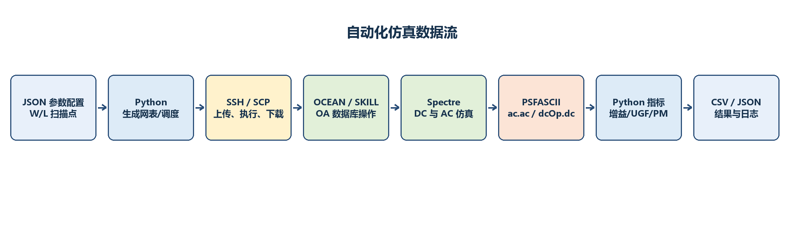
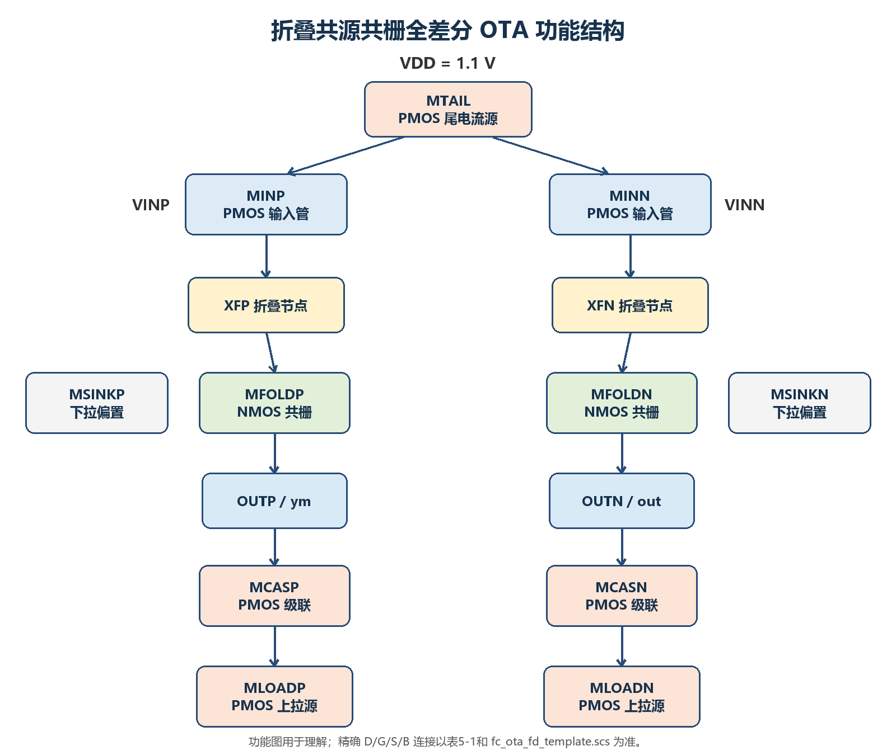
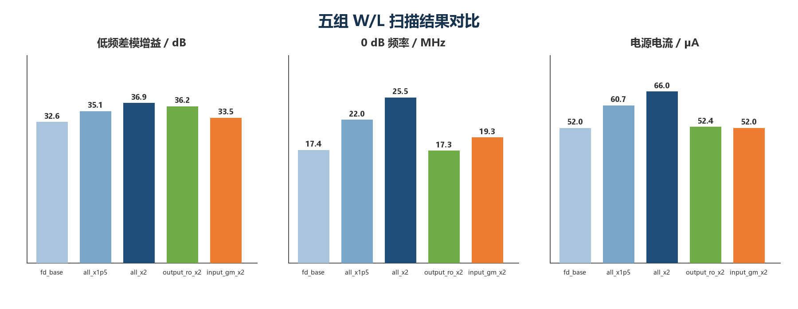
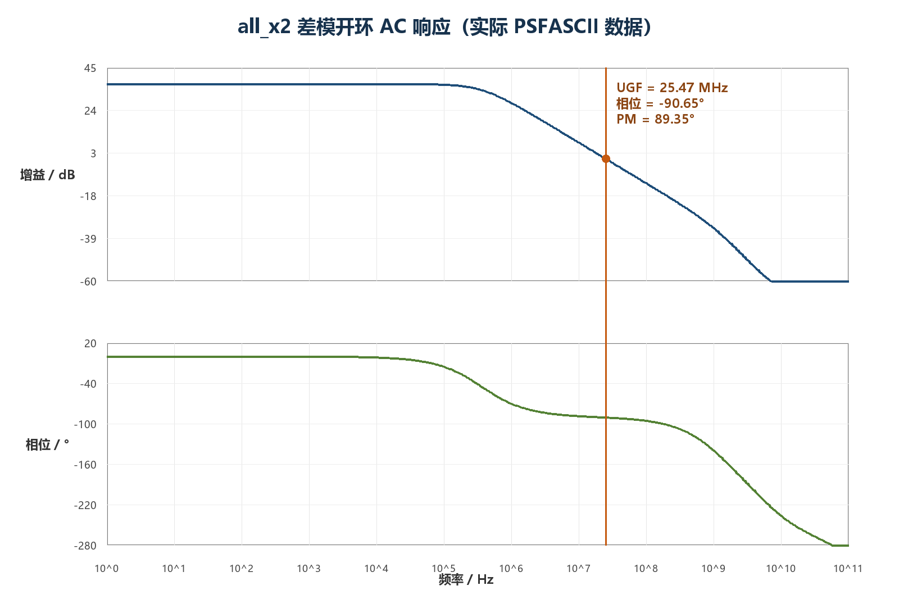

# 基于 Cadence Virtuoso、OCEAN 与 Python 的折叠共源共栅全差分 OTA 设计及自动化仿真

## 面向微电子专业本科生的课程设计报告与自学教程

工程版本：VirtuosoFoldedCascodeProject 1.0.0  
设计工艺：TSMC 40 nm CRN40LP，top_tt 典型角  
编写日期：2026 年 7 月  

## 摘要

本文以 `F:\VirtuosoFoldedCascodeProject` 中的真实工程为对象，介绍一款 PMOS 输入、全差分折叠共源共栅运算跨导放大器（Operational Transconductance Amplifier，OTA）的原理图构建、Spectre 小信号仿真、OCEAN/SKILL 数据库自动化和 Python 尺寸扫描流程。工程在 TSMC 40 nm CRN40LP PDK、1.1 V 电源、top_tt 工艺角、27 °C、每端 1 pF 负载下运行。五组 W/L 扫描中，`all_x2` 的低频差模增益为 36.93 dB，第一次下降沿 0 dB 交越频率为 25.47 MHz，交越相位为 -90.65°，由此得到开环 AC 意义下的相位裕度估算 89.35°；零差模输入时输出约为 0.554 V，电源电流约为 66.0 µA。

本报告特别区分“已经由工程数据证明的事实”和“仍需补充验证的设计结论”。当前结果是原理图级、典型角、小信号开环 AC 结果；行为源构成的理想连续时间共模反馈（Common-Mode Feedback，CMFB）并非晶体管级 CMFB；当前相位裕度也不是完整闭环 `iprobe + stb` 的环路稳定性结论。因此，本文不把该电路描述为已经达到流片要求，而把它定位为一个结构清楚、流程可复现、适合继续扩展的模拟 IC 学习工程。

关键词：折叠共源共栅；全差分 OTA；共模反馈；Virtuoso；Spectre；OCEAN；SKILL；Python；参数扫描

## 阅读说明与证据边界

本文的连接关系来自 `circuit/ocean/create_schematic.ocn` 与 `circuit/spectre/fc_ota_fd_template.scs`；尺寸组合来自 `config/fd_size_sweep.json`；数值结果来自 `results/final/fd_cmfb_sweep_results.csv`；频率曲线和直流节点来自 `results/runs/fd_cmfb_runs/all_x2/ac.ac` 与 `dcOp.dc`。工程现有 `docs/05_operations_security.md` 仍保留旧的 `.secrets` 路径描述，而实际执行脚本 `scripts/resolve_ssh_key.ps1` 已使用 `%USERPROFILE%\.ssh\virtuoso_vm_ed25519`，并明确禁止在 exFAT 项目盘保存私钥。本文以当前可执行脚本为准，并把旧文档视为待同步项。

> 初学者提示：一份可信的工程报告不能只写“理论上应该怎样”，还必须说明“这次仿真实际做了什么”。如果某项结论没有对应网表、日志或数据文件，应标记为待验证。

# 第1章 项目概述

## 1.1 项目背景

先进 CMOS 工艺为数字电路带来速度和密度优势，却使模拟设计更困难。电源电压降低后，晶体管可用的电压裕量变小；短沟道效应又降低单管输出电阻和本征增益。若只用一级普通共源放大器，很难同时获得较高增益、较宽带宽和可接受的输出摆幅。共源共栅通过提高输出电阻改善增益，而折叠共源共栅把输入支路电流“折叠”到另一类型的共栅支路，使输入共模范围和节点电压安排比望远镜式结构更灵活。

本项目选择 PMOS 输入全差分折叠共源共栅 OTA。PMOS 输入对有利于覆盖较低输入共模范围；全差分结构能提高输出摆幅利用率、抑制偶次失真和公共干扰，但必须增加共模反馈来固定输出平均电压。

## 1.2 设计目标与完成状态

工程完成了以下可验证工作：

- 在 Virtuoso OA 数据库中创建 `codex_fc_ota/folded_cascode_ota/schematic`；
- 使用 TSMC40 `nch`、`pch` 建立 11 管核心 OTA，包含 16 个网络和 11 个端口；
- 建立带行为源 CMFB、差模 AC 激励和双端 1 pF 负载的 Spectre 测试平台；
- 运行 DC 工作点和 1 Hz 至 100 GHz 的 AC 扫描；
- 通过 Python 提取低频增益、0 dB 交越频率、交越相位、相位裕度估算、输出直流电压和电源电流；
- 对五组 MOS W/L 组合进行远程批量仿真，并保存网表、PSFASCII、日志、CSV 和 JSON；
- 通过 OCEAN smoke、schematic 对象计数和 Python 单元测试验证自动化链路。

## 1.3 软件、PDK 与运行环境

主机为 Windows，Cadence 工具运行在 VMware 中的 Red Hat Enterprise Linux 9.7 来宾。主要工具路径由 `project.json` 和 `docs/01_environment.md` 给出：Virtuoso/OCEAN 为 IC25.1，Spectre 为 25.1.0.054。模型入口是 `/PDKS/TSMC40nm/models/spectre/toplevel.scs`，选择 `top_tt` section；额定电源为 1.1 V。OCEAN 当前复用来宾 GNOME 的 `DISPLAY=:1` 与 Xauthority；Spectre 命令行本身不依赖图形会话。

## 1.4 工程目录结构

`circuit/ocean` 保存 OA 数据库创建、验证和 smoke 脚本；`circuit/spectre` 保存仿真网表模板；`config` 保存 W/L 点；`src/python` 保存 SSH 调度、网表替换和指标解析；`results/final` 是权威结果；`results/runs` 保存每个点的输入与原始输出；`scripts` 提供 PowerShell 入口；`tests` 验证相位展开和交越插值；`pdk` 保存器件端口/CDF 探测报告。



图1-1 中，Virtuoso OA 数据库主要用于原理图的持久化与检查；W/L 批量性能扫描直接用模板生成 Spectre 网表。OCEAN 是 Cadence 环境中的批处理入口，SKILL 是其所使用的扩展语言；Python 负责跨平台编排和数值后处理；SSH/SCP 把 Windows 主机与 Linux EDA 环境连接起来。

# 第2章 MOSFET 与模拟集成电路基础

## 2.1 三种工作区

以长沟道 NMOS 的一级近似为例：当 `VGS < VTH` 时，沟道尚未形成，处于截止区；当 `VGS > VTH` 且 `VDS < VGS-VTH` 时，器件处于线性区，近似为受栅压控制的电阻；当 `VDS >= VGS-VTH` 时，漏端沟道夹断，进入饱和区。PMOS 可用电压绝对值写成对应条件，例如 `VSG > |VTHP|` 且 `VSD >= VSG-|VTHP|`。

在忽略速度饱和、迁移率退化和沟道长度调制的平方律模型中，NMOS 饱和电流为：

`ID = (1/2) μn Cox (W/L) (VGS-VTH)^2 = (1/2) μn Cox (W/L) Vov^2`

其中 `μn` 是电子迁移率，`Cox` 是单位面积栅氧电容，`W/L` 是宽长比，`Vov=VGS-VTH` 是过驱动电压。这个公式适合理解趋势，但 40 nm 器件的精确电流必须使用 PDK 的 BSIM 模型。

## 2.2 跨导、输出电阻与本征增益

跨导 `gm = ∂ID/∂VGS` 表示栅极小电压变化能产生多大的漏极电流变化。在平方律近似下：

`gm = μn Cox (W/L)Vov = 2ID/Vov`

`gm` 越大，输入电压转为信号电流的能力越强。考虑沟道长度调制后，饱和电流可近似写成 `ID≈ID0(1+λVDS)`，因此小信号输出电阻 `ro≈1/(λID)`。单管本征增益约为 `gm·ro`。先进工艺中沟道变短、漏端电场对沟道控制增强，`λ` 增大而 `ro` 降低，所以单管本征增益往往不高。

## 2.3 W/L 的影响

在偏置电压近似不变时，增大 W 会提高电流和 gm，同时增加栅电容、结电容和版图面积。增大 L 往往减弱沟道长度调制、提高 ro，但也可能降低单位宽度电流、增加面积并引入更大的内部节点时间常数。如果保持 W/L 不变并同时放大 W、L，理想平方律下直流电流似乎不变，但真实 PDK 中短沟道效应、寄生电容、串联电阻和版图量化会使结果发生变化。本项目 `all_x1p5` 和 `all_x2` 正是在 W/L 大体保持的同时增加绝对尺寸，用仿真观察 ro 与寄生效应的综合结果。

> 初学者提示：不能用“W 越大越好”或“L 越长增益越高”作为设计规则。模拟设计是在 gm、ro、电容、速度、噪声、摆幅、功耗和面积之间寻找可接受折中。

## 2.4 共源共栅提高增益的原因

普通共源级的小信号增益约为 `-gm·Rout`。共源共栅器件通过局部负反馈减小其源节点摆动，使下方（或上方）器件漏端电压近似固定，从而把支路等效输出电阻提高到约 `gm·ro^2` 的量级。若输入管的 gm 维持不变，输出电阻提高会直接增加低频电压增益。代价是多只器件串叠需要电压余量，并在内部节点产生额外极点。

# 第3章 差分放大器基础

## 3.1 差模与共模

两个输入可分解为平均量和差值：

`VCM = (VINP + VINN)/2`  
`VID = VINP - VINN`  
`VINP = VCM + VID/2`  
`VINN = VCM - VID/2`

例如 `VCM=0.55 V`、`VID=10 mV` 时，`VINP=0.555 V`、`VINN=0.545 V`。差分输出定义为 `VOD=VOUTP-VOUTN` 或反向定义；必须在整个工程中保持符号一致。本项目 Spectre 后处理中使用 `V(out)-V(ym)`，即网表节点 `out` 减 `ym`。OA 原理图中对应的输出名称是 `OUTN` 与 `OUTP`，因此报告涉及极性时会同时写出映射。

差模增益 `Ad=VOD/VID`；共模增益 `Acm=VOCM/VICM`；共模抑制比 `CMRR=20log10|Ad/Acm|`。当前工程没有执行共模 AC 扫描，所以不能从已有数据给出 CMRR。

## 3.2 差分对工作过程

尾电流近似固定时，一只输入管电流增加，另一只就减少。对 PMOS 输入对而言，栅压降低通常使 `VSG` 增大、支路电流增大。小差模信号被变换为两路大小相反的电流，再由高阻输出节点转换为电压。理想完全对称电路可用半电路法分析差模：对称面在差模下是交流虚地；共模下则具有不同边界条件。

## 3.3 为什么全差分输出需要 CMFB

差分反馈只约束 `VOUTP-VOUTN`，并不唯一决定 `(VOUTP+VOUTN)/2`。器件失配、偏置误差或输出电流源不平衡会使两个输出一起漂向 VDD 或 VSS，最终使部分晶体管退出饱和区。CMFB 检测输出平均值，与目标共模比较，再调节公共偏置。本项目测试平台中的 `BCMFB` 直接调节 PMOS 上拉电流源栅压 `VBPL`；这对参数比较很方便，但不是可流片的晶体管级实现。

# 第4章 共源共栅与折叠共源共栅原理

## 4.1 从共源级到折叠结构

普通共源级结构简单、摆幅较好，但输出电阻有限。望远镜式共源共栅把输入管、共栅管和负载在同一竖直支路串叠，速度和功耗效率较好，却消耗较多电压裕量，并限制输入共模范围。折叠共源共栅让输入差分对产生的增量电流进入相反类型或不同支路的共栅管，电流路径在折叠节点改变方向，因此称为“折叠”。



本项目采用 PMOS 输入对。`MINP/MINN` 从上方尾电流源取得电流，其漏端位于 `XFP/XFN`。固定下拉支路 `MSINKP/MSINKN` 与输入管电流在折叠节点形成差额；NMOS 共栅管 `MFOLDP/MFOLDN` 把差分电流传送至输出。输出上方是 PMOS 级联负载 `MCASP/MCASN` 与 `MLOADP/MLOADN`，共同提供高输出电阻。

## 4.2 信号方向的直观理解

当 `VINP` 相对升高而 `VINN` 相对降低时，PMOS `MINP` 的 |VSG| 减小、其注入 XFP 的电流趋于下降；`MINN` 支路电流趋于上升。固定下拉电流使 XFP/XFN 电压发生相反变化，NMOS 共栅支路再把这一差分电流送到 `ym/out`。在本测试平台的极性定义下，计算量是 `V(out)-V(ym)`，差模 AC 输入总幅度为 1 V，因此该复数输出差值就等于传递函数。

## 4.3 优点、代价与结构比较

折叠共源共栅的主要优点是单级结构、较高输出电阻、较好的输入共模适应性和较少的主信号级数；代价是支路更多、静态电流可能高于望远镜式结构、内部折叠节点会形成非主极点，输出摆幅仍受共栅管饱和余量限制。两级运放更容易获得高增益和大摆幅，却需要补偿并承担第二级功耗。对本项目而言，折叠结构适合用来学习“器件尺寸—输出电阻—极点—稳定性”的联系。

# 第5章 本项目电路结构分析

## 5.1 全部 MOSFET 的真实连接

表5-1依据 `create_schematic.ocn` 的 OA 连接和 `fc_ota_fd_template.scs` 的 all_x2 参数整理。Spectre MOS 端口顺序为 `(D G S B)`；PDK 探测报告 `pdk/pdk_device_report.txt` 也确认 `nch/pch` 具有 S、G、B、D 端口。

|器件|类型|D|G|S|B|W|L|nf|
|---|---|---|---|---|---|---:|---:|---:|
|MTAIL|PMOS|VSRC|VBP|VDD|VDD|20 µm|480 nm|4|
|MINP|PMOS|XFP|VINP|VSRC|VDD|40 µm|400 nm|6|
|MINN|PMOS|XFN|VINN|VSRC|VDD|40 µm|400 nm|6|
|MSINKP|NMOS|XFP|VBN|VSS|VSS|10 µm|480 nm|2|
|MSINKN|NMOS|XFN|VBN|VSS|VSS|10 µm|480 nm|2|
|MFOLDP|NMOS|OUTP/ym|VCASN|XFP|VSS|20 µm|480 nm|4|
|MFOLDN|NMOS|OUTN/out|VCASN|XFN|VSS|20 µm|480 nm|4|
|MLOADP|PMOS|ZP|VBPL|VDD|VDD|20 µm|640 nm|4|
|MLOADN|PMOS|ZN|VBPL|VDD|VDD|20 µm|640 nm|4|
|MCASP|PMOS|OUTP/ym|VPCAS|ZP|VDD|20 µm|480 nm|4|
|MCASN|PMOS|OUTN/out|VPCAS|ZN|VDD|20 µm|480 nm|4|

## 5.2 逐组功能

`MTAIL` 是 PMOS 尾电流源，`VBP=0.62 V` 控制总输入支路电流。`MINP/MINN` 把差模栅压变为反相信号电流。`MSINKP/MSINKN` 由 `VBN=0.48 V` 偏置，给折叠节点提供下拉电流和直流通路。`MFOLDP/MFOLDN` 的栅极固定为 `VCASN=0.78 V`，以共栅方式隔离折叠节点与高摆幅输出。`MLOADP/MLOADN` 的栅极是 CMFB 控制量 `VBPL`，构成上拉电流源；`MCASP/MCASN` 由 `VPCAS=0.45 V` 偏置，级联上拉负载并提升输出电阻。

## 5.3 端口、内部节点和工作点

OA schematic 的 11 个端口是 VDD、VSS、VINP、VINN、VBP、VBN、VCASN、VBPL、VPCAS、OUTP、OUTN；内部节点为 VSRC、XFP、XFN、ZP、ZN。all_x2 的 `dcOp.dc` 给出：VSRC=0.960 V，XFP=XFN=0.312 V，ZP=ZN=0.975 V，out=ym=0.5537 V，VDD 支路电流为 -66.00 µA。负号来自电压源参考方向，报告功耗电流取 `-I(VDD:p)`。

这些节点值体现了左右对称，但现有 `dcOp.dc` 没有保存每只 MOS 的 `region`、`vdsat`、`gm`、`gds` 等 operating-point 参数。因此只能检查节点没有明显贴到电源轨，不能严格宣称 11 只管全部饱和。后续应在 Spectre 中保存器件工作点并逐管验证，例如检查 NMOS 的 `VDS>VDSAT`、PMOS 的 `VSD>VDSAT`，同时查看 `gm/gds`。

## 5.4 行为源 CMFB 与 VBPL

测试平台使用：

`V(VBPL)=VBPL0 + ACMFB × ((V(out)+V(ym))/2 - VCMOUT)`

其中 `VBPL0=0.552 V`、`ACMFB=1`、`VCMOUT=0.55 V`。当输出平均值升高时，VBPL 随之升高，PMOS 上拉源的 |VSG| 减小，上拉电流下降，从而把输出拉回，形成共模负反馈。all_x2 中平均输出为 0.5536747 V，因此 VBPL=0.552+0.0036747≈0.5556747 V，与 `dcOp.dc` 完全一致。

核心 OA schematic 没有把这个行为源做进电路，而是把 VBPL 暴露为端口。这一安排便于以后连接真正的共模检测器、误差放大器和补偿网络。理想 CMFB 的优点是扫描点容易收敛且直流可比；局限是没有 CMFB 的噪声、失调、输出摆幅、速度和稳定性，也可能使系统表现比真实晶体管级实现乐观。

# 第6章 晶体管尺寸设计方法

## 6.1 尺寸选择的物理依据

输入管尺寸决定 gm、输入电容、热噪声和失配；尾电流源影响总电流和共模抑制；折叠管需要承担支路电流并保持足够 gm，以降低其源端等效阻抗；下拉偏置管决定折叠节点的直流电流平衡；PMOS 负载和级联管重点影响输出电阻、输出摆幅和高频极点。实际设计宜先由电流预算、输入共模和输出摆幅确定过驱动电压，再用 PDK 的 gm/Id 曲线选择反型程度，最后用仿真优化绝对 W、L 和 fingers。

gm/Id 方法把跨导效率 `gm/ID` 作为核心变量。较高 gm/Id 通常对应较弱反型，电流效率高但速度和面积可能受限；较低 gm/Id 对应强反型，速度较高但同等 gm 需要更多电流。本项目没有提供器件 lookup table，因此不能声称已经完成严格 gm/Id 设计；它采用五个有解释性的尺寸组合进行探索。

## 6.2 五组扫描数据

|组合|低频增益/dB|UGF/MHz|PM/°|输出/V|电流/µA|
|---|---:|---:|---:|---:|---:|
|fd_base|32.56|17.38|90.92|0.550|51.96|
|all_x1p5|35.08|22.05|90.15|0.553|60.67|
|all_x2|36.93|25.47|89.35|0.554|66.00|
|output_ro_x2|36.19|17.28|89.91|0.573|52.38|
|input_gm_x2|33.54|19.31|90.56|0.551|51.98|



`all_x1p5/all_x2` 同时增加全部器件的 W 和 L，名义 W/L 基本不变，但绝对 L 增加提高了输出电阻，W 增加帮助维持驱动能力。真实模型中偏置电流也从 51.96 µA 增加至 66.00 µA，因此增益和 UGF 同时提高并不违反增益—带宽折中，而是尺寸、工作点和电流共同变化的结果。`output_ro_x2` 只放大折叠及上拉级联相关器件，增益达到 36.19 dB，但 UGF 几乎不变，说明输出电阻提升同时伴随内部/输出电容增加。`input_gm_x2` 只把输入 W 翻倍，增益和 UGF 仅适度增加，说明仅增强输入 gm 不能替代高输出电阻。

选择 `all_x2` 是因为在本次五点集合中它同时给出最高增益和最高 UGF，且输出共模接近目标。它的代价是最高电流和更大器件面积。若设计目标强调低功耗，`output_ro_x2` 可能更有吸引力；若强调最高速度，仍需扩大搜索并检查寄生、电流密度和瞬态性能。

# 第7章 Virtuoso 原理图搭建过程

## 7.1 Library、Cell、View 与 cds.lib

Virtuoso 的 Library 类似工程库，Cell 表示一个设计单元，View 表示同一单元的不同表达，例如 schematic、symbol、layout。`cds.lib` 把逻辑库名映射到磁盘路径。本工程的实际对象是 Library `codex_fc_ota`、Cell `folded_cascode_ota`、View `schematic`，磁盘路径 `/home/userone/codex_fc_ota`。PDK 库为 `tsmcN40`。

## 7.2 手工搭建步骤

1. 在 Linux 终端进入正确 Cadence 环境，启动 Virtuoso并确认 `tsmcN40` 可见。
2. 创建并绑定工艺库；新建 `folded_cascode_ota/schematic`。
3. 从 `tsmcN40` 放置 `pch` 与 `nch`，不要用理想 MOS 代替 PDK 器件。
4. 按表5-1设置 W、L 和 nf。PDK CDF 同时存在 `Wfg`、`fingers`、`nf` 等字段，手工输入后应检查属性是否真正传入网表。
5. 放置 11 个端口，连接五个内部节点；PMOS bulk 接 VDD，NMOS bulk 接 VSS。
6. 检查同名网络、悬空栅极、交叉点和端口方向，执行 Check and Save。
7. 生成 symbol 或测试平台时，再连接偏置源、差模源、负载与 CMFB。

常见错误包括把 MOS 端口顺序误当作 D/S/G/B、漏接 bulk、把 OUTP/OUTN 极性与后处理定义混淆、只改变显示属性却没有改变 netlist 参数，以及把 nf 当成并联倍乘 m。PDK 中 nf 表示栅指数，W 的含义可能是总宽或每指宽，必须结合 CDF/netlist 确认。本工程通过 `pdk_device_report.txt` 与最终网表交叉检查。

## 7.3 OCEAN/SKILL 自动创建

`create_schematic.ocn` 先定义查找 master terminal、连接实例端口和写入 MOS 参数的过程；随后创建/打开 library 与 schematic，打开 `tsmcN40/nch/pch/symbol` master，创建 16 个网络和 11 个 term，最后逐只放置 11 个 MOS 并保存。`verify_schematic.ocn` 在新的 Cadence 进程中只读打开设计，写出实例、网络和端口数量。已验证结果为 11/16/11。

脚本搭建的优势是连接和尺寸可复现，适合批量重建；手工搭建更适合初次理解拓扑和检查图形可读性。最佳实践不是二选一，而是先用手工图理解，再用脚本保证可重复，最后在 GUI 中复核。

# 第8章 测试平台与仿真设置

## 8.1 实际测试条件

|条件|工程值|来源|
|---|---:|---|
|VDD|1.1 V|fc_ota_fd_template.scs|
|输入共模 VCM|0.55 V|同上|
|目标输出共模|0.55 V|同上|
|VBP/VBN|0.62/0.48 V|同上|
|VCASN/VPCAS|0.78/0.45 V|同上|
|差模 AC|+0.5∠0°、+0.5∠180°|同上|
|输出负载|每端 1 pF|同上|
|AC 扫描|1 Hz–100 GHz，dec=50|同上|
|温度|27 °C|dcOp.dc/日志|
|工艺角|top_tt|模型 include|

两个输入源的 AC 幅度都是 0.5，但相位相差 180°，因此 `VID=VINP-VINN=1 V`。这样 `V(out)-V(ym)` 的数值直接等于差模传递函数，不需要再除以输入幅度。若误把两个源设为同相，就会测成共模响应；若只驱动一端而没有说明，既包含差模也包含共模分量。

`dcOp dc write="dcOp"` 先求直流解；`ac ac start=1 stop=100G dec=50` 在直流工作点附近线性化。AC 仿真只描述小信号，不会告诉我们输出在大输入下是否削顶、压摆率是否足够或建立时间是否达标。

## 8.2 工作点检查方法

本次 DC 文件可检查电源、偏置、内部节点、输出对称和总电流。更完整的检查应保存每只 MOS 的 ID、VGS/VSG、VDS/VSD、VDSAT、gm、gds、region，并逐管形成表格。还应做输入共模扫描和输出共模扰动，确认 CMFB 能在目标范围内收敛。仅看到 Spectre “convergence achieved”不等于设计工作正确，它只表示方程找到数值解。

# 第9章 增益、0 dB 频率与相位裕度

## 9.1 复数频率响应

AC 仿真得到每个频率的复数输出 `H(f)=Re+jIm`。幅值为 `|H|=sqrt(Re²+Im²)`，相位为 `atan2(Im,Re)`。dB 增益为：

`Gain_dB(f)=20log10|Vout_diff(f)/Vin_diff(f)|`

本项目输入差模幅度为 1 V，所以 `Gain_dB=20log10|V(out)-V(ym)|`。代码把第一个频率点 1 Hz 的增益作为低频增益。严格来说，若电路在 1 Hz 仍受低频极点影响，应选择真正的平坦通带值；本曲线在低频处平坦，因此此定义合理。



## 9.2 0 dB 交越插值

`psfascii_metrics.py` 从低频向高频寻找第一对满足“前一点 >=0 dB、后一点 <0 dB”的样本。在对数频率轴上计算比例：

`α = G1/(G1-G2)`  
`log10(fu)=log10(f1)+α[log10(f2)-log10(f1)]`

然后对相位用同一 α 做线性插值。使用对数频率是因为 Bode 图每十倍频等距，通常比直接在线性频率上插值更合理。代码只取“第一个下降沿”交点；若增益发生多次交越，仍需结合 Nyquist 或 STB 判断稳定性。

## 9.3 相位展开与实际计算

`atan2` 输出通常限制在 -180°至+180°，曲线跨过边界时会出现 360°跳变。`unwrap_degrees` 通过给当前点加减 360°，使相邻相位差保持在 ±180°内。all_x2 插值得到 `fu=25,468,581.54 Hz`、`phase(fu)=-90.6455°`，因此：

`PM = 180° + (-90.6455°) = 89.3545°`

约 89° 的数值说明在这个差模开环传递函数定义下，单位增益交越时相位离 -180°很远。它不等于“任何闭环连接都一定稳定”：真实反馈网络、负载、CMFB 环路、输入输出共模、寄生和多重环路会改变环路增益。完整系统应在明确反馈断点处放置 `iprobe`，运行 Spectre `stb`，分别检查差模环路和 CMFB 环路的增益裕度、相位裕度及多交越问题。

> 初学者提示：0 dB 频率不是闭环 -3 dB 带宽。前者是开环增益降到 1 的频率；闭环带宽取决于反馈系数和闭环增益。相位裕度也不是从任意输出相位曲线直接读取，而应针对环路增益定义。

# 第10章 OCEAN/SKILL 自动仿真

## 10.1 OCEAN、SKILL 与 ADE 的关系

SKILL 是 Cadence 的 Lisp 风格扩展语言，可访问 OA 数据库、界面和仿真环境。OCEAN 是用于控制模拟仿真的脚本接口，也能执行 SKILL 表达式。ADE Explorer/Assembler 提供图形化设置、角落分析和结果管理；OCEAN 更适合批处理和可复现脚本。本项目用 SKILL 数据库 API 创建 schematic，用 OCEAN 可执行程序加载 `.ocn` 文件，用独立 Spectre 命令完成 W/L 大批量扫描。

## 10.2 smoke.ocn

`circuit/ocean/smoke.ocn` 只做三件事：打开 `/home/userone/codex_ocean/ocean_smoke.ok`，写入 `CODEX_OCEAN_OK`，在标准输出打印同一标记并退出。它不验证电路性能，但能快速分离“SSH/OCEAN/许可证/图形环境是否可用”和“设计脚本是否正确”两个问题。正常输出应出现 Cadence 版本信息和 `CODEX_OCEAN_OK`。

## 10.3 create_schematic.ocn 的代码层次

第一层辅助过程 `fcFindMasterTerm` 在器件 master 中按名称找端口；`fcConnect` 用 `dbCreateInstTerm` 把实例端口接到目标 net；`fcSetMosParams` 同时写入 `w/Wfg/l/nf/fingers`，兼容 PDK CDF 字段；`fcCreateMos` 统一完成放置、属性和连接。第二层创建 library、cellview、master、nets 和 terms；第三层逐实例执行连接；最后 `dbSave` 并输出报告。

脚本的优点是每个连接都显式写出，例如 `MINP` 使用 D=XFP、G=VINP、S=VSRC、B=VDD。风险是 SKILL 数据库对象合法并不自动保证电气设计正确，因此必须用网表、Check and Save、对象计数和仿真共同验证。

## 10.4 verify_schematic.ocn 与日志

验证脚本用只读模式打开 `codex_fc_ota/folded_cascode_ota/schematic`，成功时写出 `SCHEMATIC_OK INSTANCES=11 NETS=16 TERMS=11`。它验证“对象存在且数量正确”，但不能发现错误连接恰好仍保持相同数量。若要提高可靠性，可扩展脚本逐实例比较 master、W/L、每个 terminal 的 net 名称，并输出机器可读 JSON。

OCEAN 日志需要区分 warning、error 和退出码。项目 smoke 中曾出现 `cds.lib` 对同一 library 重复 DEFINE 的警告；这不影响本次脚本完成，但应通过 `UNDEFINE` 或删除重复定义消除。许可证错误、X display 错误、master cell 找不到或 SKILL `error()` 会导致非零退出或缺少完成标记。

## 10.5 非交互 shell 注意事项

SSH 执行的是非交互 shell。如果 `.bashrc` 无条件打印彩色欢迎图，SCP 协议可能被额外输出破坏。工程的 `ssh/fix_noninteractive_bash.sh` 为欢迎图增加交互判断，并保留备份。当前 OCEAN 还需要 `DISPLAY=:1` 与 `/run/user/1000/gdm/Xauthority`；若 GNOME 会话不存在，会因 X 授权失败。企业服务器更常用经过验证的无图形批处理配置、Xvfb 或调度系统，而不依赖登录桌面。

# 第11章 Python 自动参数扫描

## 11.1 模块职责

`verify_connection.py` 使用 SSH 执行 `command -v`，检查 ocean、spectre、virtuoso 路径。`remote_ocean.py` 创建远程目录、SCP 上传 `.ocn/.il`、设置 DISPLAY/XAUTHORITY、执行 OCEAN并返回标准输出与退出码。`sweep_sizes.py` 读取 JSON 扫描点、替换模板参数、逐点调用 Spectre、下载 PSFASCII并写结果。`psfascii_metrics.py` 负责纯数值解析与指标计算。PowerShell 脚本把这些模块组合成学生可以直接运行的命令。

## 11.2 JSON 到网表

`fd_size_sweep.json` 的每个对象都有唯一 `name` 和 12 个尺寸参数。`render_netlist()` 对每个参数使用带边界限制的正则表达式，要求模板中恰好匹配一次；缺参数或多重匹配都会抛出错误。这比简单字符串替换安全，因为不会把 `WIN` 误替换到其他标识符内部。生成的每个扫描点都保存在独立目录，如 `results/generated/runs/all_x2/fc_ota.scs`。

## 11.3 SSH、Spectre 与结果下载

每个点依次经历：创建远程目录；上传网表；执行 `spectre -64 +escchars -format psfascii -raw fc_ota.raw fc_ota.scs`；保存 stdout/stderr；下载 `fc_ota.raw/ac.ac` 和 `dcOp.dc`；调用 `calculate()`。任何阶段失败都会记录 `ssh_error`、`upload_error`、`spectre_error` 或 `fetch_error`，不会用零值伪装成功结果。全部点 `status=ok` 时程序才返回 0。

## 11.4 PSFASCII 解析

AC 文件中，每个频率由一行 `"freq" 数值` 开始，随后各节点以 `(实部 虚部)` 表示。`parse_ac()` 只取指定 signal；若设置 `negative_signal=ym`，代码逐点计算 `out-ym`。DC 文件按 `"名称" "类型" 数值` 解析，输出电流取 `-VDD:p`。相位展开和对数交越插值都有单元测试，测试文件人为构造 20 dB 到 -20 dB 的数据并验证 10 Hz 交越与 135° 相位裕度。

## 11.5 程序流程

1. 读取模板和 JSON，确定参数键；
2. 对扫描点名称做安全字符规范化；
3. 生成本地点目录和替换后的 netlist；
4. SSH 创建远程目录并上传；
5. 运行 Spectre DC/AC；
6. 下载 PSFASCII；
7. 解析复数波形和直流量；
8. 计算增益、UGF、相位裕度、输出、电流；
9. 写 UTF-8-SIG CSV 和 UTF-8 JSON；
10. 根据全部状态决定进程退出码。

`results/final` 是已经验收的基准，不应被日常测试覆盖；`run_final_sweep.ps1` 把新运行写入 `results/generated`。要增加偏置或 CLOAD 扫描，可在模板的 parameters 行增加参数，并在每个 JSON 点提供同名字段。若组合数迅速膨胀，应从全因子网格转向分阶段扫描、拉丁超立方、贝叶斯优化或 gm/Id 引导的搜索。

# 第12章 SSH 远程命令行方案

## 12.1 为什么采用 Windows 主机加 Linux 来宾

Cadence 与 PDK 已安装在 Linux 虚拟机中，而学生日常文件和 Codex 工作流位于 Windows。SSH 允许主机用稳定命令调用来宾，不需要远程控制 GUI 点击。它使参数、命令、日志和结果都有文件记录，尤其适合批量运行和失败重试。

## 12.2 密钥认证与安全

SSH 私钥证明主机身份，公钥放在来宾 `authorized_keys`。脚本启用 `BatchMode=yes` 和 `IdentitiesOnly=yes`，避免自动化过程中弹出密码提示或尝试无关密钥。密码不应写入 JSON、Python、PowerShell、Git 或报告。

F 盘实际为 exFAT，不支持 NTFS 的细粒度 ACL，因此不能在项目盘安全限制私钥读取。当前 `resolve_ssh_key.ps1` 的真实逻辑是：先检查 `VIRTUOSO_SSH_KEY` 环境变量，再检查 `%USERPROFILE%\.ssh\virtuoso_vm_ed25519`；找不到就明确报错。旧 `docs/05_operations_security.md` 中 `.secrets` 的描述需要更新。私钥轮换应先安装新公钥、验证新钥匙、再删除旧公钥，避免把自己锁在虚拟机外。

## 12.3 该方案是不是“最好”

不存在脱离场景的唯一最好方案。GUI 手工仿真最直观，适合搭电路和看波形，但难以复现大量点击；ADE Explorer/Assembler 对 corners、Monte Carlo 和结果管理更成熟；OCEAN/SKILL 适合 Cadence 内部自动化；Python+Spectre 灵活、易接优化器和数据处理；SSH 适合跨主机边界；企业计算集群则需要 LSF/Slurm 等调度、许可证队列和集中存储。

对“单台 Windows 主机 + 一台已安装 Cadence 的 Linux VM + 本科课程设计”而言，SSH + OCEAN/Spectre 是非常合适的折中：它保留 GUI 供学习和检查，同时让仿真可重复。若进入团队流片项目，应考虑 ADE Assembler 的 PVT/Monte Carlo 管理、版本控制、设计数据管理和作业调度。

## 12.4 分层排障顺序

先用 ping 或 VMware 网络设置确认 IP；再用 `verify_remote.ps1` 检查 SSH 身份和工具路径；然后运行 `smoke.ocn` 检查 OCEAN、许可证和 X 环境；再运行 schematic 验证；最后运行 Spectre 单点和批量扫描。分层排障避免把“许可证失败”误判为“电路错误”，也避免一上来运行耗时扫描。

# 第13章 仿真结果与分析

## 13.1 结果可信度

五个扫描点在 CSV 中均为 `status=ok`，每点都有输入网表、AC/DC PSFASCII 和 Spectre 日志；all_x2 日志以 0 errors、5 warnings、2 notices 完成。五个 warning 来自 PDK include 中多次指定 `scalefactor`，最终采用后出现的值 0.9。它们不是仿真失败，但在正式项目中应确认该模型入口和缩放方式正是 PDK 推荐用法。

## 13.2 性能解释

all_x2 相比 fd_base，增益提高 4.37 dB，UGF 提高约 46.5%，电流提高约 27.8%。相位裕度估算从 90.92°降至 89.35°，变化很小。output_ro_x2 在几乎不增加电流的情况下把增益提高到 36.19 dB，却没有提高 UGF，展示了高输出电阻与附加电容之间的折中。input_gm_x2 的增益只提高约 0.98 dB，说明输出端 ro 仍是限制因素。

所有输出直流值在 0.550–0.573 V。行为源 CMFB 目标是 0.55 V，但 `output_ro_x2` 的单端记录达到 0.573 V；由于零差模时两端对称，这也是输出共模。其偏差来自有限增益系数 ACMFB=1 和 VBPL0 设定，并非理想无限增益伺服。若要让输出更精确跟踪 0.55 V，需要调整偏置或提高/重构共模环路，同时检查稳定性。

## 13.3 是否足以流片

不能。当前只证明在典型角、27 °C、理想偏置、理想行为 CMFB、原理图级和 1 pF 负载下，小信号 DC/AC 方程能收敛并得到上述指标。没有 PVT、统计失配、噪声、大信号、真实反馈、版图和寄生结果。36.93 dB 对很多高精度闭环应用也偏低，例如单位反馈下的静态增益误差下限约为 `1/(1+A0)`，A0=70.2 V/V 时约 1.4%，尚未计入其他误差。

# 第14章 局限性与后续改进

## 14.1 当前局限

- CMFB 是行为电压源，不具备晶体管级噪声、失调、摆幅、功耗和环路极点；
- PM 由差模开环输出比估算，未用 `iprobe+stb` 验证明确反馈环路；
- 未保存完整 MOS operating point，饱和区尚未逐管确认；
- 未做瞬态、压摆率、建立时间、过载恢复和输出摆幅；
- 未扫描输入共模范围，也未仿真 CMRR、PSRR、噪声和失调；
- 只有 top_tt、27 °C、1.1 V，没有 FF/SS/FS/SF、电压和温度角；
- 没有 mismatch/Monte Carlo；
- 没有版图、DRC、LVS、PEX 和后仿真；
- 理想偏置源没有反映真实偏置电路的有限输出阻抗与噪声。

## 14.2 由易到难的学习路线

第一阶段先补齐 operating-point 保存、输入共模扫描、输出摆幅和单位增益闭环瞬态；第二阶段增加差模 STB、晶体管级 CMFB 及 CMFB STB；第三阶段完成 CMRR、PSRR、noise、PVT 与 Monte Carlo；第四阶段用 gm/Id 与脚本优化功耗—增益—带宽；第五阶段完成版图、DRC/LVS、PEX 后仿真；最后才讨论流片接口、ESD、pad、封装和测试计划。

# 第15章 可直接跟做的操作教程

## 15.1 启动与连接

1. 启动 VMware 中的 Red Hat 来宾并登录桌面，因为当前 OCEAN 复用 `:1` 图形会话。
2. 在来宾用 `ip addr` 确认 NAT IP；若不是 192.168.44.128，修改 `project.json` 与 PowerShell 脚本的 host，或直接给 Python 传 `--host`。
3. 在 Windows PowerShell 进入 `F:\VirtuosoFoldedCascodeProject`。
4. 执行 `powershell -ExecutionPolicy Bypass -File .\scripts\verify_remote.ps1`。正常输出包含 `returncode:0` 和 ocean/spectre/virtuoso 路径；失败先检查 VM 网络、密钥位置和 authorized_keys。

## 15.2 本地测试与 OCEAN 探活

执行 `.\scripts\test.ps1`。它编译主要 Python 文件、运行两个 unittest 并校验 `MANIFEST.sha256`；不会运行模拟仿真，也不会覆盖结果。ExecutionPolicy 阻止时，用当前进程的 `-ExecutionPolicy Bypass`，不要随意永久降低系统策略。

执行 `.\scripts\run_ocean.ps1 circuit\ocean\smoke.ocn`。脚本上传 OCEAN 文件到 `/home/userone/codex_ocean`，设置图形环境并运行；正常结果出现 `CODEX_OCEAN_OK`。日志在远程 `ocean_smoke.log`。若提示 license unavailable，检查许可证服务；若提示 cannot open display，检查 GNOME 会话和 Xauthority。

## 15.3 验证或重建 schematic

执行 `.\scripts\run_ocean.ps1 circuit\ocean\verify_schematic.ocn`，再查看远程 `verify_schematic.txt`，期望 11 instances、16 nets、11 terms。重建命令是 `.\scripts\run_ocean.ps1 circuit\ocean\create_schematic.ocn`；它会以写模式打开目标 schematic，属于设计数据库写操作，运行前应确认 library/cell 名称和备份。

## 15.4 运行 W/L 扫描

执行 `.\scripts\run_final_sweep.ps1`。脚本从 `config/fd_size_sweep.json` 读取五点，新结果写到 `results/generated`，不会覆盖 `results/final`。控制台逐点打印 running、status、gain 和 ugf。失败时先看相应点的 `spectre.stderr.log`，再看 stdout 最后的 errors/warnings；网络类错误由 status 字段区分。

## 15.5 查看与复算结果

打开 `results/generated/fd_cmfb_sweep_results.csv` 比较各点，JSON 适合程序读取。可直接调用：

`python src\python\psfascii_metrics.py results\runs\fd_cmfb_runs\all_x2\ac.ac results\runs\fd_cmfb_runs\all_x2\dcOp.dc --signal out --negative-signal ym`

该命令只读原始文件并打印 JSON，不覆盖数据。若返回“signal not found”，检查 PSFASCII 的节点名与大小写；若 UGF 为 null，说明扫描范围内没有第一个下降沿 0 dB 交越。

# 第16章 常见问题与故障排查

## 16.1 连接和环境

SSH timeout 通常来自 VM 未启动、IP 变化、NAT/防火墙或网卡未连接；Permission denied 则检查用户、公钥和私钥。私钥找不到时设置 `VIRTUOSO_SSH_KEY` 或放到用户 `.ssh`；不要放入 exFAT F 盘。OCEAN command not found 说明非交互 shell 没有加载 Cadence PATH，可用 `project.json` 中的绝对路径。License 错误应先检查许可证文件和服务，而不是修改电路。

`cds.lib` 重复 DEFINE 会产生 warning；统一在一个位置定义或先 UNDEFINE。PDK model not found 时核对虚拟机挂载、模型入口和 section；不要把受限 PDK 文件复制进公开项目。

## 16.2 电路和仿真

输出共模贴轨通常来自 CMFB 极性错误、偏置不合适、支路电流不平衡或器件退出饱和。MOS 端口/bulk 错误会导致异常电流甚至仍能数值收敛，因此必须查 netlist。没有 0 dB 交越可能是增益始终高于 0 dB、始终低于 0 dB、扫描 stop 太低或输出差分定义错误。相位跳变要做 unwrap；多次交越不能只取第一点下结论。

Python 找不到交越时先画 Bode 曲线，不要强行填零。某点失败要保留该点 status 与日志。CSV 为空时检查 config JSON、写权限和 Python 退出码。PowerShell 脚本受策略阻止时只对当前调用使用 Bypass。Spectre warning 不等于 error，但必须判断 warning 是否会改变模型、收敛或结果。

# 第17章 总结

本项目把模拟电路、EDA 数据库、批量仿真和数据处理连接成了完整学习链路：11 管 PMOS 输入折叠共源共栅 OTA 提供差分跨导和高输出电阻；行为源 CMFB 固定输出平均值；Spectre 给出 DC 与复数 AC 数据；Python 通过 SSH 自动生成网表、运行五个 W/L 点并提取指标；OCEAN/SKILL 则保证 Virtuoso OA 原理图可自动创建和验证。

all_x2 在当前五点集合中取得 36.93 dB、25.47 MHz 和 89.35°，说明加长并放大关键器件改善了低频输出电阻，同时工作点电流增加带来了更高 UGF。但这个结果仍是教学原型，而不是流片结论。真正完整的 OTA 设计还需要器件 operating point、晶体管级 CMFB、STB、瞬态、噪声、PVT、统计、版图和后仿真。对大二学生而言，最重要的收获不是记住某个 W/L，而是学会沿着“结构—偏置—小信号模型—仿真设置—原始数据—指标—局限”这一证据链思考。

# 附录A 项目目录及文件功能表

|路径|功能|
|---|---|
|README.md / project.json|项目入口、环境和最佳结果|
|circuit/ocean/*.ocn|OCEAN/SKILL 探活、创建和验证 schematic|
|circuit/spectre/*.scs|Spectre 拓扑与测试平台模板|
|config/*.json|W/L 扫描点|
|src/python/remote_ocean.py|远程 OCEAN 调用|
|src/python/sweep_sizes.py|批量网表、Spectre 和结果管理|
|src/python/psfascii_metrics.py|PSFASCII 与指标|
|results/final|权威 CSV/JSON|
|results/runs|每点网表、AC/DC 和日志|
|pdk/pdk_device_report.txt|PDK 器件端口/CDF 探测|
|scripts/*.ps1|用户操作入口|
|tests|指标算法单元测试|

# 附录B 主要 MOSFET 参数速查

all_x2：输入对 40 µm/400 nm/nf6；尾源 20 µm/480 nm/nf4；NMOS 折叠管 20 µm/480 nm/nf4；下拉源 10 µm/480 nm/nf2；PMOS 上拉源 20 µm/640 nm/nf4；PMOS 级联管 20 µm/480 nm/nf4。完整逐管端口见表5-1。

# 附录C OCEAN/SKILL 关键命令速查

`ddGetObj/ddCreateLib` 获取或创建库；`dbOpenCellViewByType` 打开 cellview/master；`dbCreateNet/dbCreateTerm` 创建网络与端口；`dbCreateInst` 放置实例；`dbCreateInstTerm` 连接实例端；`dbCreateProp` 写属性；`dbSave/dbClose` 保存和关闭；`outfile/fprintf/close` 写报告；`error` 终止并报告错误。

# 附录D Python 自动仿真程序流程

配置读取 → 模板参数唯一替换 → 本地独立目录 → SSH 建远程目录 → SCP 网表 → Spectre DC/AC → 保存日志 → SCP PSFASCII → 差分复数波形 → 相位展开 → 对数频率交越插值 → CSV/JSON → 汇总退出码。

# 附录E 主要指标及公式速查

`VID=VINP-VINN`；`VOD=V(out)-V(ym)`；`Ad=VOD/VID`；`Gain_dB=20log10|Ad|`；`VCM=(VINP+VINN)/2`；`VOCM=(VOUTP+VOUTN)/2`；`CMRR=20log10|Ad/Acm|`；`PM=180°+phase(L(jωu))`。本项目 PM 是差模开环 AC 估算，完整环路应以 STB 的 loop gain 为准。

# 附录F 常用运行命令

```powershell
cd F:\VirtuosoFoldedCascodeProject
powershell -ExecutionPolicy Bypass -File .\scripts\verify_remote.ps1
.\scripts\test.ps1
.\scripts\run_ocean.ps1 circuit\ocean\smoke.ocn
.\scripts\run_ocean.ps1 circuit\ocean\verify_schematic.ocn
.\scripts\run_final_sweep.ps1
```

# 附录G 术语和缩写

OTA：Operational Transconductance Amplifier，运算跨导放大器。CMFB：Common-Mode Feedback，共模反馈。PDK：Process Design Kit，工艺设计套件。OA：OpenAccess，Cadence 设计数据库格式。UGF：Unity-Gain Frequency，单位增益频率。PM：Phase Margin，相位裕度。PVT：Process/Voltage/Temperature。PSFASCII：Spectre 可读文本结果格式。STB：Spectre 稳定性分析。DRC/LVS/PEX：设计规则检查、版图与原理图一致性检查、寄生参数提取。

# 附录H 后续仿真检查清单

- [ ] 保存并审核每只 MOS 的 region、VDSAT、gm、gds、ID；
- [ ] 输入共模范围和输出摆幅；
- [ ] 单位反馈瞬态、压摆率、建立时间；
- [ ] 差模 STB 与 CMFB STB；
- [ ] CMRR、PSRR、输入/输出噪声；
- [ ] TT/FF/SS/FS/SF、温度和 VDD；
- [ ] mismatch 与 Monte Carlo；
- [ ] 晶体管级 CMFB 与偏置电路；
- [ ] layout、DRC、LVS、PEX 和后仿真。

# 附录I 课程答辩问题与参考回答

## I.1 为什么选择折叠共源共栅而不是两级运放？

参考回答：本项目希望用单级高阻输出节点获得较高增益和较宽带宽，同时学习输入共模范围、折叠节点和共栅输出电阻。两级运放可获得更高增益和摆幅，但需要频率补偿，问题重点不同。

## I.2 为什么两个 AC 输入都是 0.5 V？

参考回答：两者相差 180°，所以总差模幅度是 0.5-(-0.5)=1 V。这样输出差值数值直接等于传递函数。

## I.3 为什么相位裕度 89°仍不能说系统一定稳定？

参考回答：当前只是差模开环输出比的交越相位估算，没有在真实反馈网络中测 loop gain，也没有检查 CMFB 环路和多重交越。应增加 iprobe+stb。

## I.4 为什么 all_x2 的 W/L 近似不变，性能仍改变？

参考回答：真实器件不只由 W/L 决定。绝对 L 改变沟道长度调制和 ro，绝对 W/L 影响寄生、电阻、版图量化；偏置电流也发生变化，所以增益与 UGF会改变。

## I.5 当前最大的工程简化是什么？

参考回答：行为源 CMFB 和理想偏置。它们保证比较方便，却没有真实共模环路的速度、噪声、失调、摆幅和稳定性。

## I.6 怎样证明 MOS 在饱和区？

参考回答：保存器件 operating point，逐管比较 NMOS 的 VDS 与 VDSAT、PMOS 的 VSD 与 VDSAT，并检查 region、gm、gds。仅有节点电压或仿真收敛不足以严格证明。

## I.7 这个 OTA 可以流片了吗？

参考回答：不能。还缺 PVT、Monte Carlo、噪声、大信号、真实 CMFB、版图、DRC/LVS、PEX 和后仿真等验证。

## I.8 SSH/OCEAN 是最好方案吗？

参考回答：对单机 Windows+Linux VM 的课程项目很合适，因为可复现且能批量运行；团队项目可能更适合 ADE Assembler、版本控制和计算集群调度。选择取决于规模和验证目标。

# 参考工程文件

本文未引用外部 PDK 机密模型内容。主要依据文件为：`README.md`、`project.json`、`docs/01_environment.md`、`docs/02_circuit_design.md`、`docs/03_automation.md`、`docs/04_results.md`、`circuit/ocean/create_schematic.ocn`、`circuit/ocean/verify_schematic.ocn`、`circuit/spectre/fc_ota_fd_template.scs`、`config/fd_size_sweep.json`、`src/python/*.py`、`results/final/fd_cmfb_sweep_results.csv`、`results/runs/fd_cmfb_runs/all_x2/ac.ac`、`dcOp.dc` 和 `spectre.stdout.log`。

# 输出前自检结论

已核对 11 只 MOS 的连接与 all_x2 尺寸；扫描表来自 final CSV；Bode 图来自 all_x2 原始 PSFASCII；已区分低频增益、UGF 与闭环带宽；已把 PM 标明为开环 AC 估算；已把行为 CMFB 标明为非晶体管级；未声称完成流片；未记录登录密码、私钥或 PDK 模型正文。需要进一步确认的项目是逐管 operating point、完整 STB、PVT/统计、大信号和版图后仿真。
